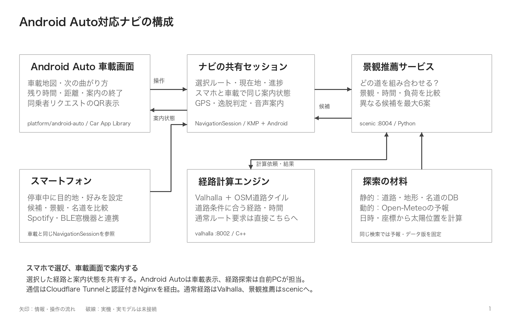
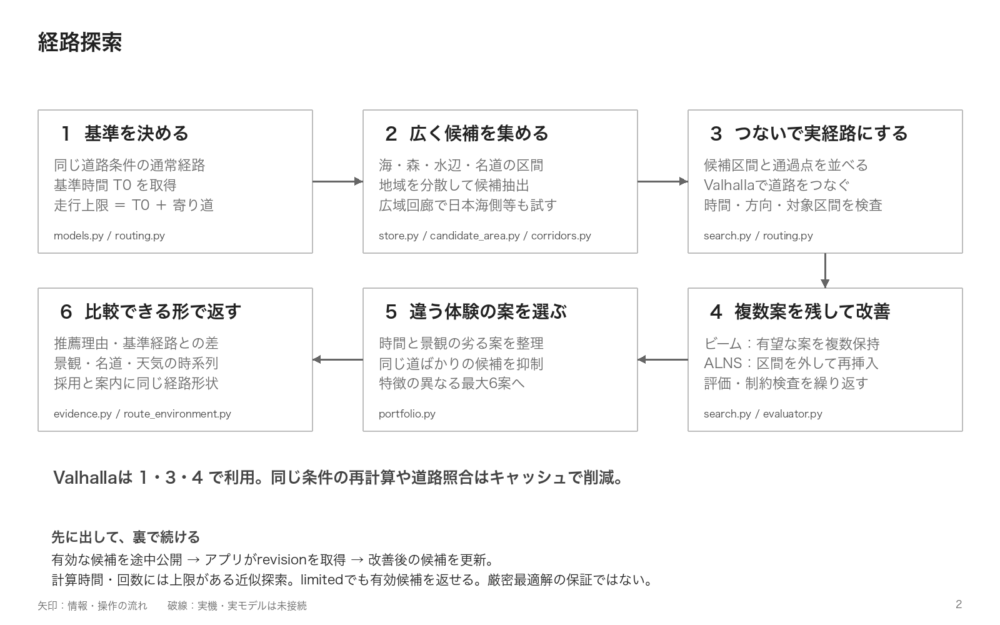
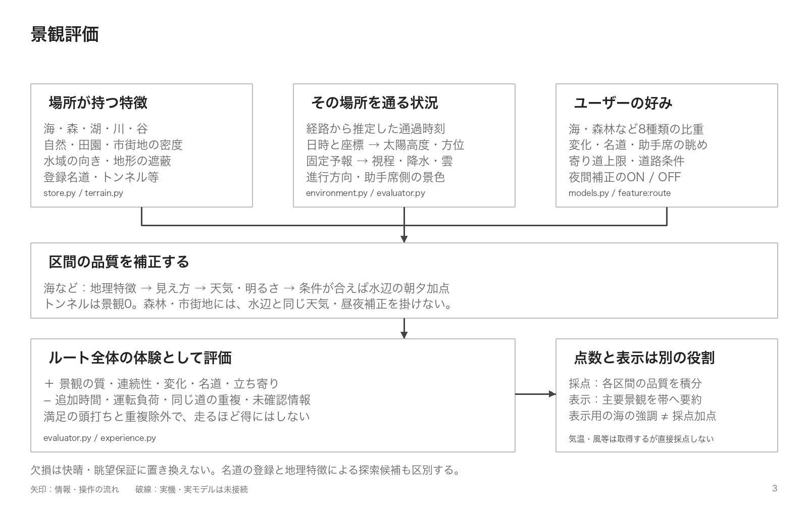
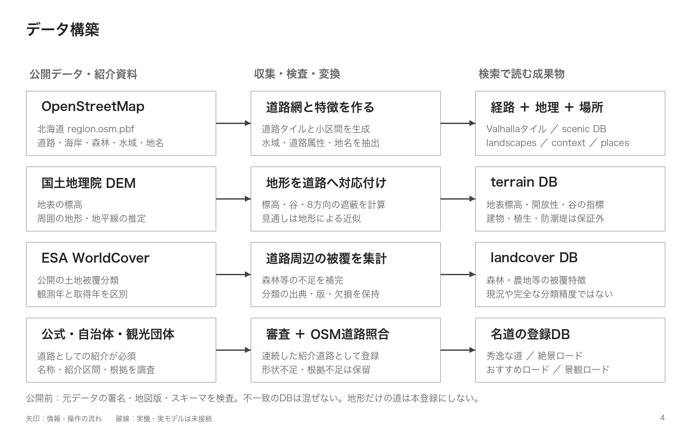
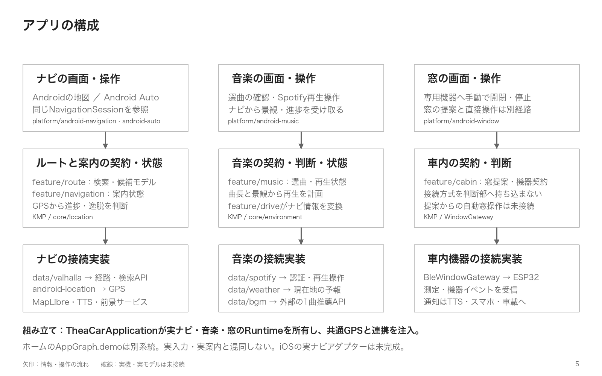
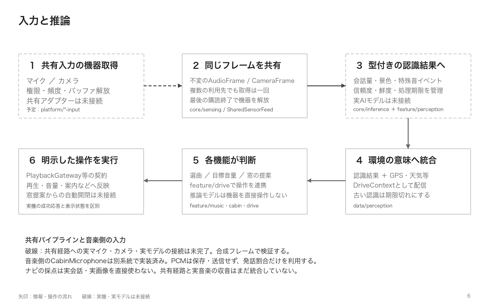
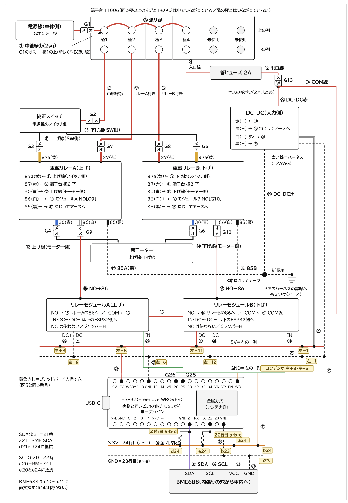
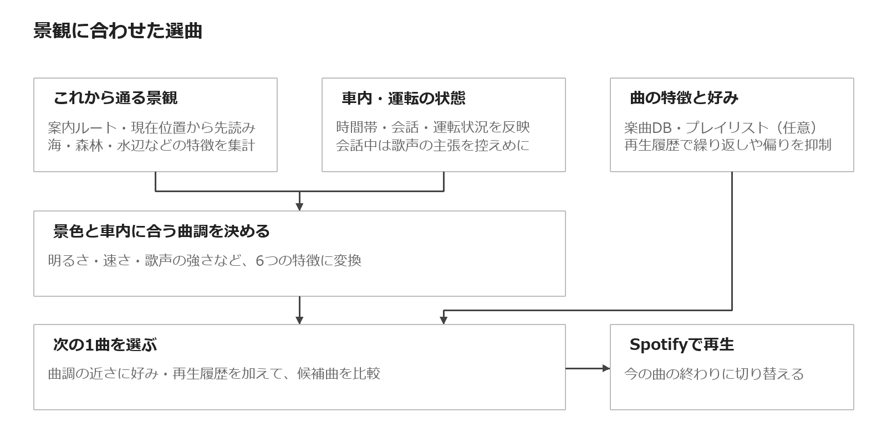

# 旅れこ

## PV1
https://github.com/user-attachments/assets/54f053a4-6567-4c07-b462-cc3ff3e8f046

## PV2
https://github.com/user-attachments/assets/210fd430-2355-444c-afe4-2f15dc2d6831

[デモ動画(Youtube)](https://youtu.be/KT4o08DKyFY)


旅れこは、移動そのものを楽しむためのAndroid Auto対応ナビです。
海・森・湖・川、天気や太陽の位置をもとに、許容できる寄り道の範囲で走って気持ちいい道を探します。

スマートフォンで候補を比べ、選んだルートを車載画面で案内します。景観に合わせたSpotifyの選曲、専用機器による窓操作、写真付きの旅の記録にも対応しています。

旅行は、旅行先についてからがスタートだと考える人はたくさんいると思います。しかし、私たちは、旅行先につくまでの車移動ももっと楽しめると考えています。例えば、街中の道よりも海沿いを走ったほうが爽快な気分になれるのは想像に難くないはずです。でも、現状はその道中を楽しむということは、ないがしろにされがちです。一般的なGoogle Mapなどのナビも目的地までを最短・最速でつなぐものでしかありません。

旅れこは、その道中を、旅でいちばん楽しい時間にします。

対象地域は北海道です。

## ユーザーストーリー

1. 車載ナビに「旅れこ」を接続する
2. 目的地を入力してルートを決める
   - [特徴①](#特徴①-最短・最速ではなく楽しい道を選ぶ)：最短・最速ではなく、楽しい道を選ぶ
3. 音楽は旅れこにおまかせ。聴きたい曲は同乗者がリクエスト
   - [特徴②](#特徴②-走っている道と車内の雰囲気に合った曲をセレクト)：走っている道、車内の雰囲気に合った曲をセレクト
   - [特徴③](#特徴③-運転手以外が各自のスマホから曲をリクエスト)：運転手以外が、各自のスマホから曲をリクエスト（予約）
4. 楽しくドライブをする
5. 旅の思い出にひたる
   - [特徴④](#特徴④-走った道と思い出の写真をステッカーとwebサイトに保存)：走った道、思い出の写真をステッカーとWebサイトに保存
6. また旅に出る

## 旅れこの特徴
### 特徴① 最短・最速ではなく楽しい道を選ぶ

寄り道してもいい時間を決めると、その範囲で海・森・湖など好みの景色を長く楽しめる道を探します。景色の移り変わりや、各地の名道を通るかどうかも比べて、雰囲気の違う複数のルートを提案します。
候補を比べ、選んだルートを車載画面で案内します。

操作は[ナビの操作](docs/navigation.md)、探索と評価の仕組みは[経路探索アルゴリズム](docs/route-algorithm.md)を参照してください。

#### Android Autoでのナビゲーション

車載画面にはAndroid for Cars App Libraryのナビ用テンプレートを使っています。地図の描画、ルートのプレビュー、案内開始・終了、右左折情報、残り時間・距離を実装しています。

- スマートフォン：停車中の目的地検索、景観の好み・寄り道上限の調整、候補の比較
- Android Auto：選択したルートの確認と案内、車載地図の表示
- 共通の案内処理：GPS・経路進捗・逸脱判断・音声案内。スマホと車載で別々の案内状態を作らない

DHU（Desktop Head Unit）とAndroid Auto対応ナビでの起動確認、未確認の走行条件は[車載での確認手順](docs/android-auto-setup.md)にまとめています。

### 特徴② 走っている道と車内の雰囲気に合った曲をセレクト

案内中のルートの景観と車内の状態をもとに、Spotifyから次の1曲を選びます。ナビで案内を始めると、選曲も自動で始まります。

使い方は[景観BGMの使い方](docs/bgm-recommendation.md)、選曲の仕組みは[音楽推薦の設計](docs/bgm-recommendation-design.md)を参照してください。

### 特徴③ 運転手以外が各自のスマホから曲をリクエスト

車載画面に表示したQRコードを同乗者が読み取ると、自分のスマホで曲を検索して、リクエストできます。同乗者はSpotifyにログインする必要はありません。予約曲がある間は予約を優先し、なくなると特徴②の選曲に戻ります。

受付サーバーと動作確認は[同乗者の曲リクエスト](infra/music-requests/README.md)を参照してください。

### 特徴④ 走った道と思い出の写真をステッカーとWebサイトに保存

目的地に到着すると走行記録が保存されます。写真・地名・メンバーを加えると、走った道の形をかたどったステッカーができます。ステッカーのQRコードからは、地図上の経路や時刻まで見られるWebサイトを開くことができます。

作り方は[旅のステッカー](docs/memory-sticker.md)、Webサイトは[Web版](docs/memory-web.md)を参照してください。

## 車載で案内するルートを、どう選ぶか

札幌から函館までの実際の探索です。海・森林・川・湖に加え、通過時刻・太陽・天気を考慮して候補を比較する流れを示しています。


https://github.com/user-attachments/assets/1eb10c6c-3b0d-4dad-ab50-349dd7b00ebd


約2分・音声なし。実際の探索結果を可視化した動画で、車載画面の録画ではありません。


## 車載ナビを支える仕組み

### スマホと車載画面で、一つの案内状態

Android Autoの車載画面とスマートフォンが同じ`NavigationSession`を参照します。自前PCの景観推薦とValhallaが候補を作り、選択した経路を共通の案内処理へ渡します。スマホは主な設定・比較の入口、車載画面は運転中の案内の表示先です。



### 経路探索

通常ルートを基準に景観区間を組み合わせ、道路網上の経路と所要時間を確認します。有望な案を組み替えながら特徴の異なる候補を残し、選んだ形状をそのまま車載ナビの案内へつなぎます。



### 景観評価

地理的な特徴を通過時刻・太陽・予報で補正し、景観の連続性や名道、追加時間、道の重複などをルート全体で評価します。



<details>
<summary>データ構築・アプリの分担・入力と推論・窓操作の機器</summary>

### データ構築

公開データから道路の特徴を事前に計算し、検索時は地図版の一致したDBを参照します。



### アプリの分担

共通の契約・状態管理と、画面・外部API・OS固有の処理を分けています。



### 入力と推論

入力取得・共有・認識・機能判断・実行の境界です。破線は共有経路への実機・実モデルの接続が未完了の部分を示します。



### 窓操作の機器

助手席の窓を、ESP32とにおいセンサーBME688で動かす機器の配線です。車載リレーが切れているときは純正スイッチの配線がそのまま使え、車側はギボシでつなぐので元に戻せます。部品と書き込み手順は[窓操作の機器](hardware/window-ai/README.md)にまとめています。



</details>

### 景観に合わせた選曲

これから通る景色と車内の会話に合わせて、Spotifyで流す次の1曲を選びます。海沿いでは明るく広がりのある曲、森林では落ち着いた曲を選びやすくします。



好みを反映するには、音楽画面の「みんなのプレイリスト」で表示名とSpotifyプレイリストURLを入力し、「取り込む」を押します。「プレイリスト内だけ」を選ぶと、取り込んだ曲だけから選曲します。

[使い方](docs/bgm-recommendation.md) · [推薦の仕組み・図解](docs/bgm-recommendation-design.md) · [全体の設計](docs/architecture.md)

## ドライブとの連携

- 景観BGM：案内中のルートと車内の状態に合わせてSpotifyの曲を選び、再生する
- 同乗者のリクエスト：車載画面に受付用QRを表示し、同乗者が自分のスマホから曲を予約する
- 換気の通知：ESP32機器のイベントを音声・スマホ・車載画面へ通知する。窓の手動操作はスマホの専用画面で行う
- 旅の記録：到着時に走行記録を保存。写真やメンバーを加えてステッカーにし、QRから共有ページを開く

## 車載画面で試す

まず[環境構築手順](docs/environment-setup.md#新規環境)に沿って経路APIとAndroid端末を準備し、スマホで検索できることを確認します。その後、[Android Autoの確認手順](docs/android-auto-setup.md)へ進み、DHUまたは対応ナビで車載画面を開きます。アプリのAPKは車載機ではなくスマートフォンへインストールします。

APKだけでは経路検索できません。PC側のAPI、道路・景観データ、認証の準備が必要です。生成データと資格情報はGitに含めません。

構築済みの環境では、Docker Desktopを起動してから実行します。

```sh
.venv-scenic/bin/python infra/valhalla/manage.py up
.venv-scenic/bin/python infra/valhalla/manage.py check
```

`up`はコンテナを再作成するため、検索・案内中には実行しないでください。外出先から使う場合は、[Cloudflare Tunnelの設定](docs/environment-setup.md#11-外でも使う--cloudflare-tunnel)も必要です。

音楽には[Spotifyの設定](docs/spotify-setup.md)、窓の操作には[専用機器の設定](docs/window-control.md)を行います。旅の共有ページは[Web版の手順](web/README.md)を参照してください。

## 設計とデータ

| 資料 | 内容 |
| --- | --- |
| [アーキテクチャ](docs/architecture.md) | 全体図、モジュールの責務、入力と推論、実装状況 |
| [経路探索アルゴリズム](docs/route-algorithm.md) | 候補生成、景観評価、時間制約、複数案の選抜、API |
| [音楽推薦の設計](docs/bgm-recommendation-design.md) | 景観の先読み、音楽6軸への変換、好み・履歴による採点と抽選（図解） |
| [ナビの操作](docs/navigation.md) | 目的地検索、好みの調整、候補比較、景観タイムライン |
| [公開データ](docs/public-routing-data.md) | 取得元、利用条件、地理・地形・土地被覆の扱い |
| [道路の登録基準](docs/scenic-road-registry-policy.md)・[道路台帳](docs/scenic-road-registry.md) | 名道の選定、出典、対象区間、本登録と保留 |
| [開発ガイド](CONTRIBUTING.md) | 担当範囲、依存境界、テスト |

## 技術構成

ナビの契約・状態管理はKotlin Multiplatform、共通UIはCompose Multiplatform、Android Autoの画面はAndroid for Cars App Libraryで実装しています。スマホと車載画面は同じ案内セッションを使い、景観探索はPython、走行経路の計算は自前のValhallaが担当します。

```text
androidApp/   Androidの起動・機能の組み立て
shared/       共通UIと依存の組み立て
core/         共通の値・位置・環境・入力・推論の契約
feature/      ルート・案内・音楽・車内・旅の記録
data/         API・気象・Spotify等の接続実装
platform/     Android Auto・スマホの地図・GPS・再生・機器操作
infra/        Valhalla・景観推薦・BGMのサーバーとデータ構築
web/          旅の記録の共有ページ
hardware/     窓操作機器のファームウェア・配線
docs/         設計・構築・運用資料
```

## 対応状況

Android Auto向けに開発中です。iOSのナビは未対応です。

## 使用データ・ツール・参考資料

### データ

- [OpenStreetMap](https://www.openstreetmap.org/copyright) / [Geofabrik 北海道](https://download.geofabrik.de/asia/japan/hokkaido.html) — 道路・海岸線・森林・水域
- [国土地理院 標高タイル](https://maps.gsi.go.jp/development/demtile.html) — 標高・地形の評価
- [ESA WorldCover](https://esa-worldcover.org/en/data-access) — 土地被覆（2021 v200）
- [Open-Meteo](https://open-meteo.com/en/docs) — 天気予報
- [北海道開発局「秀逸な道」](https://www.hkd.mlit.go.jp/ky/kn/dou_kei/slo5pa0000009at1.html) — 認定された景観道路

各道路の紹介元は[道路台帳](docs/scenic-road-registry.md)、データの取得元・利用条件は[公開データ](docs/public-routing-data.md)にまとめています。

### ツール・公式ドキュメント

- [Kotlin Multiplatform](https://kotlinlang.org/multiplatform/) / [Compose Multiplatform](https://kotlinlang.org/compose-multiplatform/) — 共通ロジック・UI
- [Android for Cars App Library](https://developer.android.com/training/cars/apps/navigation) — Android Autoのナビ画面・案内
- [Valhalla](https://valhalla.github.io/valhalla/) — 経路計算
- [MapLibre Native](https://maplibre.org/maplibre-native/docs/book/) / [OpenFreeMap](https://openfreemap.org/) — 地図表示
- [Spotify Web API](https://developer.spotify.com/documentation/web-api) / [Android SDK](https://developer.spotify.com/documentation/android) — 音楽検索・再生
