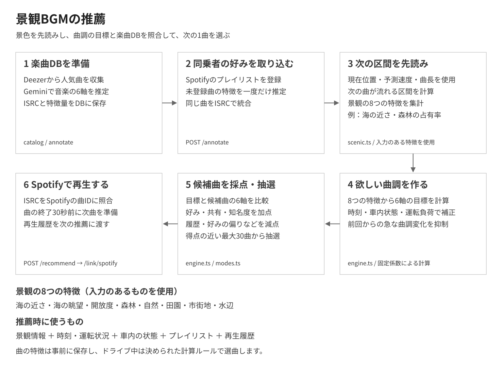
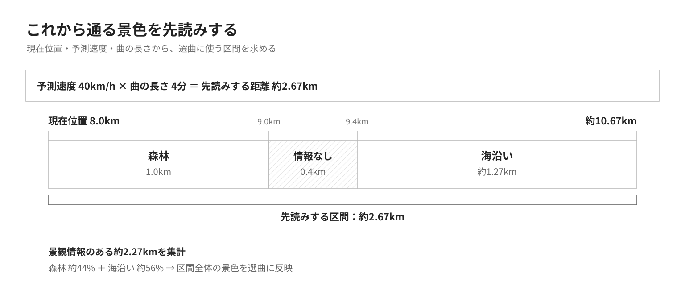
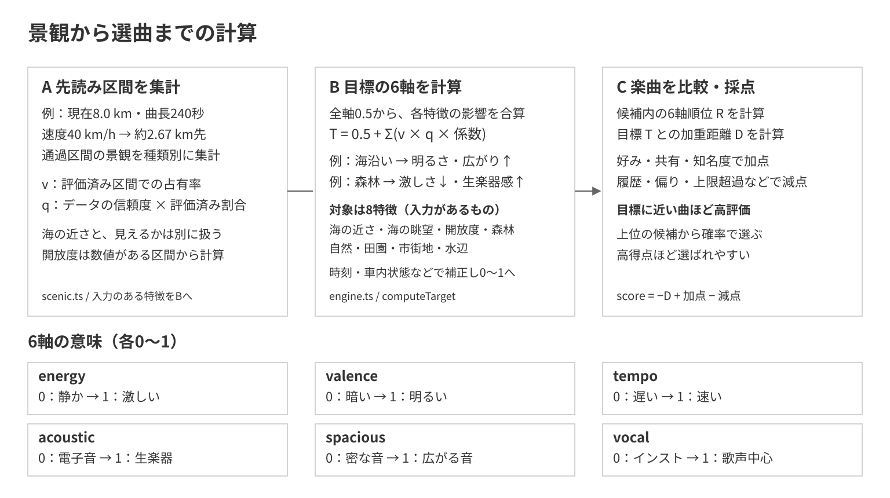

# 景観BGM推薦の仕組み

旅れこの景観BGMは、**これから通る景色と車内の様子に合わせて、Spotifyで流す次の1曲を選ぶ機能**です。プレイリストの登録は任意です。登録すると、景色に合う曲の中から、同乗者の好みも反映して選びます。

例えば、海沿いでは明るく広がりのある曲、森林では落ち着いた生楽器中心の曲を選びやすくします。会話が弾んでいるときは歌声の主張を抑え、誰か1人の好きな曲ばかりが続かないように再生履歴も使います。

## 選曲から再生までの流れ

| 段階 | すること |
| --- | --- |
| ① 曲を準備する | 曲の印象を6つの特徴で表し、楽曲データベースに保存する |
| ② 好みを取り込む（任意） | 好みを反映したい場合に、同乗者のSpotifyプレイリストを登録する |
| ③ 景色を先読みする | 次の曲が流れる間に通る区間から、景観の8つの特徴を集計する |
| ④ 合う曲調を決める | 景色・時間帯・会話・運転状況から、選びたい曲の特徴を決める |
| ⑤ 次の1曲を選ぶ | 曲調の近さに、好み・知名度・再生履歴を加えて比較する |
| ⑥ Spotifyで再生する | 再生できる曲を照合し、今の曲の終わりに切り替える |

①はあらかじめ用意する楽曲カタログ、②は好みを反映したい場合に行う任意の登録です。プレイリストを登録しなくても、カタログから景色や車内の様子に合わせて選曲します。ドライブ中は③〜⑥を繰り返し、進む先の景色や車内の変化を次の選曲に反映します。

## 1. 曲の印象を6つの特徴でそろえる

景色と曲を結び付けるために、楽曲の印象を次の6軸で表します。各軸は0〜1の数値で、曲同士を比べる共通の物差しになります。

| 特徴 | 0に近い曲 | 1に近い曲 |
| --- | --- | --- |
| **激しさ**（energy） | 静かで穏やか | 激しく、高揚感がある |
| **明るさ**（valence） | 暗い・切ない | 明るい |
| **速さ**（tempo） | ゆっくり | 速い |
| **生楽器らしさ**（acoustic） | 電子音・打ち込み中心 | 生楽器中心 |
| **広がり**（spacious） | 音が密集している | 余白や広がりがある |
| **歌声の強さ**（vocal） | インストゥルメンタル | 歌声が前面に出る |

例えば「きらり / 藤井 風」は、激しさ0.78、明るさ0.75、歌声の強さ0.85という特徴を持ちます。このように「明るい」「歌声がはっきりしている」といった印象を数値にして保存します。

音楽配信サービスの一つであるDeezerから、ドライブの選曲候補となる邦楽・洋楽・K-POP・インストゥルメンタルなど、複数のカテゴリの人気曲を収集しています。これらをまとめた2,057曲のカタログを、楽曲データベースに用意しています。曲名とアーティスト名をもとにGeminiが6軸や知名度を推定し、保存します。**ドライブ中の選曲は、保存した特徴と決められた計算ルールを使って行います。**

### 同乗者のプレイリストを加える（任意）

好みを反映した選曲を楽しみたい場合は、音楽画面の「みんなのプレイリスト」で、表示名とSpotifyプレイリストURLを入力して取り込みます。「好み＋新しい曲との出会い」では、**登録したプレイリスト内の曲と、そこに含まれるアーティストの別の曲**を加点し、選ばれやすくします。例えば、藤井 風の曲を登録すると、その登録曲に加えて、候補にある藤井 風のほかの曲も加点の対象になります。取り込むリストは、連携中のSpotifyアカウントが所有しているか、共同編集できるものを使います。

同じ曲が複数人のリストにあれば、1曲にまとめて「誰のリストに入っているか」を記録します。照合には、録音ごとに付けられた識別コード「ISRC」を使います。まだデータベースにない曲は6軸の特徴を作って追加し、保存済みの曲はその特徴を再利用します。

## 2. 今いる場所だけでなく、これから通る景色を見る

1曲が流れている間にも、車は先へ進みます。そこで、ナビの経路と現在位置、予測速度、曲の長さから、**次の曲が流れる間に通る区間**を見積もります。次の曲はまだ決まっていないため、長さの目安には今流れている曲を使います。

例えば、現在位置が経路の8.0km地点、予測速度が40km/h、今の曲が4分なら、約2.67km先の10.67km地点までが対象です。

この区間に含まれる景色を距離で集計します。上の例では、景観情報がある約2.27kmのうち、海沿いが約56%、森林が約44%です。1地点の景色ではなく、区間全体の景色を選曲に使います。

景観情報はOpenStreetMapの海岸線や森林などの地図データをもとにしています。図Aでは、区間内の景観を種類別に集計し、選曲に使う「強さ」と「信頼度」を求めます。

- **強さ（v）**：景観を評価できた区間のうち、その景観が占める割合です。
- **信頼度（q）**：カテゴリの信頼度に、評価済みの割合を掛けた値です。評価済みの割合は、先読み区間と重なる全ブロックの長さを分母にして求めます。

海・森林・自然・湖・川・谷・市街地（カテゴリ名が `urban` のもの）は、カテゴリの信頼度を既定値1として扱います。`confidence` が0以下のブロックは評価対象から外しますが、正の値であれば、例えば0.3でもその値を信頼度に掛けません。その他の対応カテゴリは、区間長で加重平均した `confidence` を使います。

`unknown` や `confidence` が0以下のブロックは、評価済みの割合を下げます。一方、**ブロック自体がない隙間は計算の分母に含めません。** 上の図の「情報なし0.4km」がブロックのない隙間で、海・森林のブロックがどちらも評価対象なら、評価済みの割合は1となり、海・森林の信頼度も1です。

海の近さと海の眺望は別に扱います。海沿いでも、眺望が確認された区間だけが「海の眺望」の対象です。開放度は、数値がある区間を距離で重み付けして平均し、その区間が全ブロック長に占める割合を信頼度に使います。

## 3. 景色と車内の様子から、選びたい曲調を決める

**図Bの海沿い・森林は一例です。** 選曲では、海の近さ・海の眺望・開放度・森林・自然・田園・市街地・水辺の8つの特徴を対象に、入力された特徴の影響を合算します。未入力の特徴や、強さ・信頼度が0の特徴は加算しません。

まず6軸の目標をそれぞれ0.5から始め、各特徴の「強さ × 信頼度 × 曲調への係数」を加えます。時刻や車内の状態などで補正し、目標を0〜1の範囲に収めます。

| 景観の特徴 | 選びたい曲調 |
| --- | --- |
| **海の近さ** | 明るく、広がりのある曲 |
| **海の眺望** | 明るさ・高揚感・広がりのある曲 |
| **開放度** | 明るく、広がりのある曲 |
| **森林** | 激しさを抑えた、生楽器中心の落ち着いた曲 |
| **自然** | 少し穏やかで、生楽器の響きがある曲 |
| **田園** | 明るく、ゆったりした生楽器寄りの曲 |
| **市街地** | 少し速く、音の密度が高い曲 |
| **水辺** | 穏やかで、広がりのある曲 |

例えば、森林だけの区間で景観情報の信頼度が1の場合、激しさの目標は0.5から0.4に下がり、生楽器らしさは0.5から0.75に上がります。海と森林が混ざる区間では、それぞれの割合に応じて両方の特徴を反映します。

### 時間帯・会話・運転状況も反映する

景色から決めた曲調を、そのときの状況に合わせて補正します。

| 状況 | 選曲への反映 |
| --- | --- |
| 夜（19時〜翌4時） | 激しさを抑える |
| 朝（4時〜9時） | テンポを上げる |
| 会話が盛り上がっている | 歌声の主張を抑える |
| 車内が静か | 明るさを上げ、知名度の高い曲や複数人のリストにある曲を選びやすくする |
| 長時間の運転で車内が静か | 激しさ・速さ・歌声の主張を抑える |
| 運転負荷が高い・カーブが続く | 激しさや歌声が強すぎる曲の評価を下げる |

車内の様子は、スマホのマイクで発話の有無を端末内で判定して求めます。**音声そのものは保存・送信しません。** マイクを許可しなくても景観BGMは利用でき、その場合は車内を通常の状態として選曲します。

また、景色の切り替わりで曲調が急変しないように、前回の目標からの変化は各軸最大0.25に抑えます。

## 4. 景色への合いやすさに、みんなの好みを重ねる

### 選曲する範囲を決める

アプリでは、次の2つの選び方を使えます。

| 選び方 | 候補にする曲 |
| --- | --- |
| **好み＋新しい曲との出会い** | 旅れこのカタログと、取り込んだプレイリストの曲。リスト内の曲や、そのアーティストの曲を加点する |
| **プレイリスト内だけ** | 取り込んだプレイリストの曲だけ。候補がなくなってもリスト外の曲には切り替えない |

推薦APIには、カタログから景観と車内の状態を中心に選ぶ `discover` モードもあります。「好み＋新しい曲との出会い」は `blend`、「プレイリスト内だけ」は `playlist` に対応します。

### 6軸を比べて、候補曲に点数を付ける

候補曲の6軸を、目標の曲調と比べます。このとき使うのは、候補の中での相対的な順位です。例えば明るさの目標が0.7なら、「候補の中で明るい方から約3割の位置にある曲」を探します。これにより、カタログから選ぶ場合も、プレイリストだけから選ぶ場合も、その範囲に合わせて明るめ・穏やかといった特徴を比べられます。

目標に近い曲ほど高く評価し、さらに好みと履歴を反映します。

| 評価すること | 点数への反映 |
| --- | --- |
| 目標の曲調に近い | 評価を上げる。景観の特徴が明確なときは、その景観に関わる軸を重視する |
| プレイリスト内の曲・同じアーティストの曲 | 「好み＋新しい曲との出会い」で加点する |
| 複数人のプレイリストに入っている曲 | 好みを反映するモードで加点する |
| 知名度の高い曲 | カタログを使うモードで加点する |
| 直近3曲と同じアーティスト | 減点し、連続を抑える |
| 特定の人のリストの曲が続いている | 直近10曲の偏りに応じて減点する |
| このドライブで再生した曲 | アプリから渡された再生履歴に含まれる曲を候補から外す |

### 上位の曲から、点数に応じて1曲を選ぶ

最高点との差が0.1以内の曲を最大30曲集め、点数が高い曲ほど選ばれやすい確率で1曲を選びます。同じ道でも選曲に幅が生まれる仕組みです。

景色に合う候補がない場合は、直前の曲の特徴を基準に選び直し、曲調の流れを保ちます。

## 5. 選ばれた曲をSpotifyで再生する

推薦APIは、選んだ曲と次点の候補をアプリに返します。アプリは曲の識別コードをSpotifyの曲と照合し、再生できる曲を選びます。最初の候補が見つからないときは、次点も含めて最大5曲を順に確認します。

**今の曲の終了30秒前に次曲を準備し、残り1.5秒で再生を切り替えます。** 再生した曲を履歴に加え、次の選曲に使います。同乗者の予約曲があるときは予約を優先し、予約がなくなると景観BGMに戻ります。

## 実際の選曲イメージ

**海沿いを走るとき**

先読みした区間に海沿いが多ければ、明るさと広がりを重視します。「好み＋新しい曲との出会い」では、その曲調に近い曲の中で、同乗者のリストにある曲や好きなアーティストの曲が選ばれやすくなります。直前と同じアーティストなら減点し、上位候補から1曲を選びます。

**自然の多い区間で、車内が静かなとき**

自然に合わせて激しさを抑え、生楽器寄りの曲調を目標にします。静かな車内では知名度や共有曲の加点を強めるため、穏やかな曲調に近く、みんなになじみのある曲が選ばれやすくなります。

**森林の中で、会話が弾んでいるとき**

森林に合う落ち着いた曲調に、歌声を控えめにする補正を加えます。プレイリストやカタログの中から、その特徴に近い曲を探し、同乗者の好みと再生履歴を反映して選びます。

---

詳しい仕様：[景観BGMの使い方](bgm-recommendation.md) · [推薦の計算詳細](bgm-recommendation.md#推薦の計算詳細) · [API仕様](../infra/bgm-api/docs/API.md)