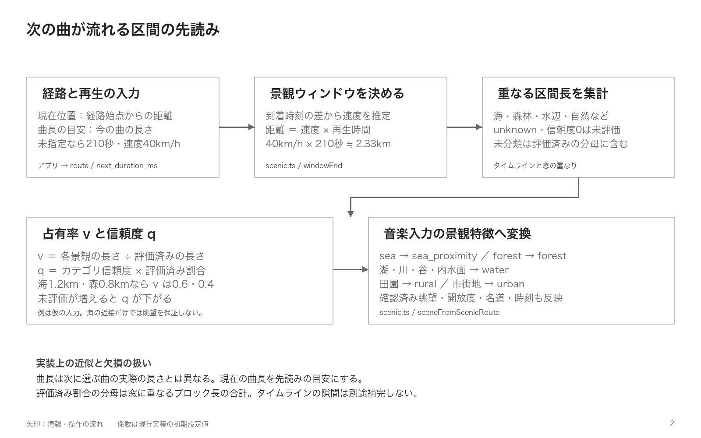
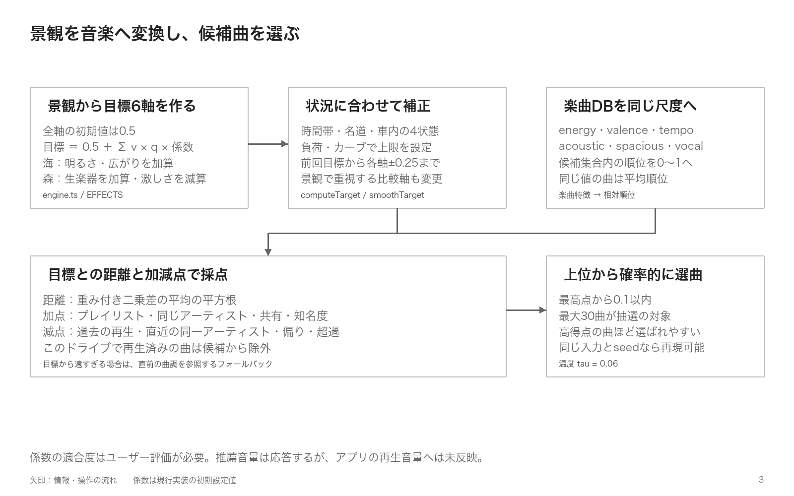

# 景観BGMの推薦

旅れこは、次の曲が流れる間に通る景観を先読みし、同乗者の好み・車内の状態・再生履歴に合わせてSpotifyの次の1曲を選びます。推薦は自前PCのBGMサービスで計算し、アプリが曲の終わり30秒前に次曲を準備して、残り1.5秒で再生を切り替えます。

設計の中心は、**景観を音楽6軸の目標へ変換し、候補曲との距離と好みの加減点で採点して、上位の近い点数の曲から確率的に選ぶ**ことです。図は「景観の先読み」と「目標から選曲まで」の2枚に絞り、係数・計算式・動作ルールは以下の文章と表で説明します。

## どの情報を使うか

| 入力 | 取得元 | 選曲への使い方 |
| --- | --- | --- |
| ルートの景観・経路進捗・到着予測時刻 | ナビと景観ルートエンジン | 次の曲の間に通る景観の占有率と信頼度を求める |
| 曲長の目安 | Spotifyで現在流れている曲 | 先読みする区間の長さを決める |
| 車内の状態 | マイクから端末内で検出した発話の有無 | 会話・静けさ・休息に合わせて曲調を補正する |
| 同乗者の好み | 取り込んだSpotifyプレイリスト | リスト内の曲、同じアーティスト、複数人の共有曲を加点する |
| 再生履歴 | アプリ内の再生結果 | 曲の繰り返し、同一アーティストの連続、一人への偏りを抑える |
| 候補曲の特徴量 | 自前の楽曲DB | 音楽6軸・知名度・注釈の信頼度で比較する |

景観はOpenStreetMapの道路周辺にある海岸線・森林・水域などから推定します。海への近さと眺望確認は別の特徴として扱います。楽曲DBの未注釈曲は、Geminiが曲名・アーティスト名から特徴量を推定して保存します。景観から曲調への変換は固定係数を使うルールベースです。

## 次の曲が流れる区間を先読みする

現在の経路進捗と到着予測時刻から速度を推定し、曲が流れる間に進む距離を求めます。

```text
先読み距離[km] = 予測速度[km/h] × 曲長の目安[秒] / 3600
```

次の曲はまだ選ばれていないため、アプリは今の曲の長さを目安として送ります。長さが未指定なら210秒、速度を推定できなければ40km/hを使います。この場合は約2.33km先までが対象です。



窓に重なる景観区間を長さで集計し、各特徴を「強さ `v`」と「信頼度 `q`」にします。

```text
v = その景観の区間長 / 評価済み区間長
q = カテゴリの信頼度 × 評価済み割合
評価済み割合 = 評価済み区間長 / 窓と重なる全ブロック長
```

例えば評価済み2kmのうち海が1.2km、森林が0.8kmなら、海の強さは0.6、森林は0.4です。`unknown` や信頼度0は未評価とし、占有率の分母から除いて信頼度を下げます。タイムラインの隙間は分母へ自動補完しません。OSM由来カテゴリの基本信頼度は1で、補助データ由来では区間の信頼度も反映します。

海は `sea_proximity`、森林は `forest`、湖・川・谷・内水面は合算して `water` へ変換します。眺望確認済みの海は `sea_visibility`、開放度は距離加重平均した `openness` として扱います。

## 景観から目標の曲調を作る

| 軸 | 0に近い | 1に近い |
| --- | --- | --- |
| `energy` | 静か | 激しい・高揚感がある |
| `valence` | 切ない・暗い | 明るい |
| `tempo` | 遅い | 速い |
| `acoustic` | 電子音・打ち込み | 生楽器中心 |
| `spacious` | 密な音像 | 余白・広がりがある |
| `vocal` | インスト | ボーカルが前面に出る |

各軸の初期値は0.5です。景観の強さと信頼度を掛けた量に応じて、次の係数を足します。

```text
目標値 T[a] = 0.5 + Σ（特徴の強さ v[f] × 信頼度 q[f] × 係数 E[f,a]）
```

| 景観 | energy | valence | tempo | acoustic | spacious | vocal |
| --- | ---: | ---: | ---: | ---: | ---: | ---: |
| 海の近さ | +0.10 | +0.20 | +0.05 | 0 | +0.15 | 0 |
| 海の眺望確認 | +0.10 | +0.10 | 0 | 0 | +0.15 | 0 |
| 開放度 | 0 | +0.05 | 0 | 0 | +0.25 | 0 |
| 森林 | −0.10 | 0 | −0.05 | +0.25 | −0.05 | −0.05 |
| 自然 | −0.05 | 0 | 0 | +0.15 | +0.05 | 0 |
| 田園 | 0 | +0.10 | −0.05 | +0.10 | +0.05 | 0 |
| 市街地 | +0.10 | 0 | +0.05 | −0.15 | −0.20 | 0 |
| 湖・川・谷 | −0.10 | 0 | −0.05 | +0.05 | +0.20 | −0.05 |

さらに時間帯と車内の状態を補正します。夜は `energy −0.10`、朝は `tempo +0.05`、名道では `energy +0.10`。会話が盛り上がっているときは `vocal −0.20`、静かなときは `valence +0.05`、休息時は `energy −0.20`・`tempo −0.10`・`vocal −0.20` とします。静かな車内や名道では知名度・共有の加点倍率を2.5にします。

運転負荷が高い入力ではenergy上限0.60・vocalソフト上限0.50、カーブの入力ではそれぞれ0.65・0.60を設定します。名道で負荷が高くない場合は既存のenergy上限を0.15緩和し、その後、休息なら上限0.40を適用します。目標は0〜1と各上限の範囲へ収め、前回の目標があれば各軸の変化を±0.25に抑えた後、上限を再適用します。

係数はどれも初期値です。定数にまとめ、走行テストとユーザー評価で調整する前提です。

- [src/engine.ts](../infra/bgm-api/src/engine.ts)：景観の効果量、目標、重み、距離、スコア、確率抽選。
- [src/modes.ts](../infra/bgm-api/src/modes.ts)：モードごとの候補範囲と加減点の係数。
- [src/scenic.ts](../infra/bgm-api/src/scenic.ts)：景観の先読み、占有率、信頼度。

## 候補曲を採点し、上位から確率的に選ぶ



まず、モードに応じて候補範囲を決め、このドライブで再生済みの曲を除外します。各曲の6軸を候補集合内の順位 `R`（0〜1、同値は平均順位）へ変換し、目標 `T` との距離を計算します。目標は「候補内のどのあたりの曲調が欲しいか」を表します。

```text
距離 D = √（Σ w[a] × (T[a] − R[a])² / Σ w[a]）
```

通常の重みはenergy・valence・acoustic・spacious・vocalが1、tempoが0.5です。最も強い景観の `v×q` が0.3以上なら、その景観の効果量が大きい上位2軸の重みを1.5（tempoなら0.75）にします。候補内の値の幅が0.2未満の軸は、さらに `値の幅 / 0.2` 倍して影響を弱めます。

距離が小さいほど基本点は高く、そこへ次の加減点を行います。

```text
score = −D
        −0.30 × 過去ドライブの再生済みフラグ
        −0.15 × 直近3曲と同一アーティストのフラグ
        −所有者係数 × 所有者の再生偏り
        ＋共有係数 × 共有度 × 知名度等の倍率
        ＋知名度係数 × 知名度 × 知名度等の倍率
        ＋好みの加点
        −0.20 × max(0, 0.6 − 楽曲注釈の信頼度)
        −1.00 × energy等の上限超過量
        −0.30 × vocal等のソフト上限超過量
```

| モード | 候補範囲 | 知名度係数 | 共有係数 | 所有者係数 | 好みの加点 |
| --- | --- | ---: | ---: | ---: | --- |
| `discover` | 全曲。所有者情報は使わない | 0.05 | 0 | 0 | なし |
| `blend`（既定） | 全曲＋同乗者の好み | 0.10 | 0.10 | 0.40 | リスト内+0.10、同一アーティスト+0.04。重ねない |
| `playlist` | 同乗者のリスト内 | 0 | 0.10 | 0.40 | 追加なし |

所有者の偏りは、直近10曲の再生割合が均等割合 `1 / 同乗者数` を超える量です。複数所有者の曲では最小の超過量を使います。共有度は、同乗者が2人以上で所有者がいる場合に `(所有者数−1) / (同乗者数−1)` で求めます。Androidの「プレイリスト内だけ」は `include_catalog=false` を指定し、候補が尽きてもカタログへ戻しません。

上限を満たす曲があればその中から選び、1曲もなければ超過の少ない曲へフォールバックします。候補の最小距離が0.35を超える場合は、参照可能なら直前曲の曲調を基準に採点し直し、推奨音量を0.1下げます。この推奨音量は表示だけで、端末内の会話連動制御とは別です。

### 最高点の曲に固定せず、近い点数の曲から抽選する

**スコア順で最高点から0.1以内の曲を集め、その中の最大30曲を抽選対象にします。** 上位5曲に固定する方式ではありません。点数が近い曲にも機会を残しつつ、高得点ほど選ばれやすくします。

```text
抽選集合 S = score ≥ 最高score − 0.1 を満たす上位最大30曲
重み z[i] = exp((score[i] − 最高score) / 0.06)
選曲確率 P[i] = z[i] / Σ z[j]  （j は S の曲）
```

同じ入力と同じ `seed` なら結果は再現できます。APIの `chosen` は抽選で選ばれた曲で、`candidates` はその曲を先頭に置き、残りをスコア順で返します。返却候補数の `top_k`（既定5）と抽選対象数（最大30）は別です。

## 例：海沿いの区間

特徴が「海の近さ0.9、海が見える0.8（信頼度0.7）、開放感0.8」の場合です。ほかの信頼度は1、時刻14時、車内は通常、名道・負荷・カーブ・前回目標の補正なしとします。

- **ターゲット**：energy 0.65、valence 0.78、tempo 0.55、acoustic 0.50、spacious 0.92、vocal 0.50（小数第2位へ丸めた表示）。
- **重み**：valenceとspaciousが1.5、tempoが0.5、その他は1。

例えば `energy = 0.5 + 0.9×0.10 + 0.8×0.7×0.10 = 0.646`、`spacious = 0.5 + 0.9×0.15 + 0.8×0.7×0.15 + 0.8×0.25 = 0.919` です。「明るく、広がりがあり、候補の中ではやや速めの曲」が欲しいという指定になります。tempo 0.55は特定のBPMそのものではありません。

[38曲の検証用プール](../infra/bgm-api/test/fixtures/tracks.json)を使い、`blend`・所有者なし・履歴なし・`seed=1` で実装を実行すると、スコア上位5曲は次のとおりです。このプールには知名度がなく、今回は加減点が0のため `score = −D` です。

| スコア順位 | 曲 | 距離 D | score | 選曲確率 |
| --- | --- | ---: | ---: | ---: |
| 1 | 幾億光年 / Omoinotake | 0.216 | −0.216 | 17.6% |
| 2 | きらり / 藤井 風 | 0.216 | −0.216 | 17.5% |
| 3 | タイムパラドックス / Vaundy | 0.220 | −0.220 | 16.6% |
| 4 | マリーゴールド / あいみょん | 0.226 | −0.226 | 15.0% |
| 5 | Plastic Love / 竹内まりや | 0.243 | −0.243 | 11.2% |

抽選対象は合計9曲で、この表以外の4曲にも確率があります。`seed=1` では4位の「マリーゴールド」が選ばれました。表示のスコア・距離は小数第3位へ丸めていますが、抽選は丸める前の値で計算するため、見かけ上同点でも確率が少し異なります。

## 例：自然の多い区間で、馴染みのある曲を選ぶ

特徴が「自然0.9（信頼度1）」で、車内が静かになっている場合です。時刻14時、名道・運転負荷・カーブ・前回目標の補正なしとします。自然に合わせて激しさを抑え、生楽器らしさと広がりを高めます。車内が静かなので明るさを0.05加え、知名度・共有の加点倍率を2.5にします。

- **ターゲット**：energy 0.455、valence 0.550、tempo 0.500、acoustic 0.635、spacious 0.545、vocal 0.500。
- **重み**：energyとacousticが1.5、tempoが0.5、その他は1。

例えば `energy = 0.5 − 0.9×0.05 = 0.455`、`acoustic = 0.5 + 0.9×0.15 = 0.635` です。「自然の景観に合わせて少し落ち着いた、生楽器寄りの曲調にしつつ、馴染みのある曲を選びやすくする」という指定になります。

[現行カタログ](../infra/bgm-api/catalog/catalog.jsonl)2,057曲、`blend`・所有者なし・履歴なし・`seed=1` で実装を実行したスコア上位5曲は次のとおりです。この条件では共有や好みの加点はなく、`score = −D + 0.10×2.5×知名度` で計算します（上位の曲は信頼度不足などの減点も0）。知名度はカタログに登録された指標で、同乗者全員が実際に知っていることを保証するものではありません。

| スコア順位 | 曲 | 距離 D | 知名度 | score | 選曲確率 |
| --- | --- | ---: | ---: | ---: | ---: |
| 1 | 真珠のピアス / 松任谷由実 | 0.039 | 0.763 | +0.152 | 9.8% |
| 2 | プラスティック・ラブ / 竹内まりや | 0.091 | 0.878 | +0.129 | 6.6% |
| 3 | W / X / Y / Tani Yuuki | 0.081 | 0.808 | +0.121 | 5.8% |
| 4 | 4:00A.M. / 大貫妙子 | 0.095 | 0.814 | +0.108 | 4.7% |
| 5 | 喜劇 / 星野 源 | 0.114 | 0.886 | +0.108 | 4.7% |

例えば「喜劇」は、目標との距離が約0.114で、知名度による加点が `0.10×2.5×0.886 = 0.2215` です。したがって **scoreは約+0.108** となり、上位候補に入ります。景観への近さだけでなく、静かな車内で馴染みのある曲を流しやすくする補正が効いています。

抽選対象は30曲です。`seed=1` では「春泥棒 / ヨルシカ」が選ばれました。距離は約0.124、知名度は0.811で、**scoreは約+0.078、選曲確率は2.9%**です。このように最高点の曲に固定せず、景観への適合と知名度を合わせた上位候補の中で選曲に幅を持たせます。表と計算例の表示値は丸めており、実装は丸める前の値で採点・抽選します。

## Spotifyでの再生

推薦APIは曲のIDと次点候補を返し、アプリが `/link/spotify` で最大5件を照合します。照合結果はDBで再利用し、最初に見つかった再生可能な曲をSpotifyで流します。候補全曲の特徴量を毎回Spotifyへ問い合わせる構成ではありません。

アプリ内で次曲を準備し、曲の終わりに切り替えて再生結果を確認します。同乗者の予約曲がある間は予約を優先し、予約がなくなると景観BGMへ戻ります。再生結果は次の推薦の履歴へ渡します（端末の保持は直近200曲まで）。実走行での発話判定・曲間切り替えと、係数が景観に合うかのユーザー評価は別途検証が必要です。

<details>
<summary>操作・アプリの分担・設定・運用上の制約</summary>

## ナビからの動線

景観BGMはナビの流れの中で始めます。音楽画面を先に開く必要はありません。

| 場面 | 画面 | 動作 |
| --- | --- | --- |
| ルートのプレビュー | 「案内を開始」の直上に「♪ 景観BGM」の1行とスイッチ | 再生先と選曲の根拠を一言で示す。未連携なら「連携する」、再生先が無ければ「Spotifyを開く」。スイッチの状態は保存する |
| 「案内を開始」 | 初回だけマイクの許可 | 断られても案内と推薦は始める（車内は normal） |
| 案内が GUIDING になった | — | 流れている曲（前の曲・手動で選んだ曲・音楽画面で始めた景観BGM）に関係なく、すぐ選び直す。現在位置が経路に乗り景観を渡せるまで最大10秒待ってから最初の1曲を選ぶ |
| 案内中 | 画面下のミニプレーヤー（タブバーの上） | 1行目に Spotify で実際に流れている曲（再生中だけ動く音量バー付き）、2行目に選曲の一言（無ければ車内の様子）。再生／一時停止ボタンで止めても次の曲へは進まず、再開すると続ける。手動で選んだ曲なら「BGMに戻す」、問題があれば「再試行」「入手」などをその場に出す。収まらない文字はゆっくり横に流す |
| 到着・案内終了 | — | ナビから始めた推薦だけを止める。流れている曲は最後まで流れる |

運転中に見る表示はミニプレーヤー1つにまとめ、2行・操作は再生ボタンともう1つまでに絞っています。一時停止した曲は、曲の途中で止まっている間は次の曲を選びません（曲の終わりと区別します）。

再生先は「選択中 → 前回流せた再生先 → Spotify で再生中の端末 → このスマホ」の順に選びます。「このスマホ」は App Remote SDK で端末の Spotify アプリを裏で起動して鳴らすので、利用者が Spotify アプリを開く必要はありません（[設定](spotify-setup.md#このスマホで再生するapp-remote-sdk)）。Spotify アプリが入っていないときは「入手」を案内します。ナビ画面に戻ると再生先を取り直します。

音楽画面で始めた推薦も、案内の開始で案内のルートの景色を使って選び直し、案内の終了で止まります。同乗者の名前は音楽画面で入力した値を保存し、ナビから始めるときにも使います。

ナビと音楽のモジュールは互いに依存しません。`platform/android-navigation` の `NavigationCompanion` が画面の差し込み口と開始前の権限だけを定義し、`androidApp` の `NavigationMusicCompanion` が `platform/android-music` の `DriveBgmLink` へ案内の開始・終了を伝えます。`DriveBgmLink` は `AndroidSpotifyRuntime` を直接触らず、必要な状態と操作だけを持つ `DriveBgmPort` と、選択の保存先 `DriveBgmSettings` を受け取ります。

## 担当範囲

### プレイリストを入力する

音楽画面の「みんなのプレイリスト」で表示名とSpotifyプレイリストURLを入力し、「取り込む」を押す。
ログイン中のアカウントが所有または共同編集できるリストが対象。同乗者のリストは、そのアカウントを共同編集者に追加する。
初回は「読取権限を追加してSpotifyに再ログイン」から許可する。各人がブラウザで認証する機能はまだない。

複数の表示名・リストを追加でき、同じ曲はISRCで統合して所有者を保持する。
1リスト最大1,000項目、最大20リスト、合計は重複を除いて5,000曲まで。上限超過は途中取込で成功扱いにせずエラーにする。
ローカル曲・再生不可・ISRCなし・音楽以外は除外し件数を表示する。
既存の`/annotate`へ50曲ずつ送り、未注釈の曲だけサーバーで特徴を準備する。
サーバーの`GEMINI_API_KEY`が必要な曲を含む場合、未設定・失敗なら取込を確定しない。以前の取込は保持し、再試行はキャッシュを再利用する。

- 「好み＋新しい曲との出会い」: `blend`。リスト内と同じアーティストの曲を優先し、TheaCarカタログも候補にする。
- 「プレイリスト内だけ」: `playlist`と`include_catalog=false`。カタログのインスト補完もせず、候補が尽きてもリスト外に戻さない。

取込とモードは音楽画面・ナビからの開始で共有する。景観BGMパネルにプレイリストの入力欄は無く、取込は必ずこの「みんなのプレイリスト」で行う。リストを取り込んでいるときは、その所有者が同乗者になる。変更は推薦終了後に行う。
リストの更新を反映するには、削除して取り込み直す。QRでのプレイリスト登録や同乗者ごとのSpotifyログインは未実装。
取込結果は端末メモリ内で保持し、プロセス終了・連携解除・Client ID変更で消える。
SpotifyアクセストークンやプレイリストURLはBGMサーバーへ渡さず、曲名・アーティスト・曲ID・曲長と所有者の表示名を渡す。
曲の類似度による好みの拡張と発見割合の固定制御は次の段階で、今回の`blend`は既存の加点方式を使う。

取得条件: [Spotify Get Playlist Items](https://developer.spotify.com/documentation/web-api/reference/get-playlists-items)。
景観入力は[経路探索アルゴリズム](route-algorithm.md)の既存タイムラインを使用する。

| モジュール | 所有する処理 |
| --- | --- |
| feature/music | `BgmRecommendationService` の契約、`SceneryRoute` などの入力型、`BgmMusicSession` の要求条件・履歴・次候補への切り替え、`BgmPlaybackLoop` の再生状態の取得間隔、`PlaybackMonitor` の画面向けの再生状態、`CabinSpeechMonitor`・`SpeechActivityDetector` の発話の検出、`CabinMoodTracker` の車内の状態の判定、`CabinVolumeController` の減音量の判断、`MusicLogUploader` の記録の保存と再送 |
| data/bgm | `/recommend`・`/link/spotify` の HTTP、JSON の組み立てと解釈、状態コードの対応づけ。Web 版の `/api/music-logs` への送信（`MusicLogApi`） |
| feature/drive | `NavigationSceneryTimeline`。ナビ・ルートの型から音楽側の型への変換 |
| platform/android-music | 部品の組み立てとおまかせ再生との排他（`AndroidSpotifyRuntime`）、Spotify の認証（`SpotifyAuthController`）、画面と入口、マイクの収音（`AndroidMicrophone`）、前景サービス（`CabinListeningService`）、音量制御の連携（`CabinVolumeSession`）と端末操作（`AndroidMusicVolume`）、記録のファイル保存 |
| data/spotify | `progress_ms` を含む再生状態の取得、曲URIの再生 |

`feature/music` は `feature/route` と `feature/navigation` に依存しません。景観タイムラインの対応づけは `feature/drive` だけが知っています。

## 次の曲を決める条件

今の曲は最後まで流します。次の曲は曲の終わりの少し前に決めてアプリ内で準備しておき、今の曲の残りが 1.5 秒を切ったところでアプリから再生を切り替えます。曲の終わりが近い（残り 8 秒以内）あいだは、再生状態を 5 秒おきではなく 0.75 秒おきに確かめます。

| 状況 | 動作 |
| --- | --- |
| 始めたとき（案内の開始・「流す」「BGMに戻す」） | 流れている曲に関係なく、すぐ選んで再生する |
| 流れている曲が残り 30 秒以内 | 次の曲を選んで準備する。今の曲は止めない |
| 流れている曲が残り 1.5 秒以内 | 準備した曲を再生する（選曲の一言もここで切り替える） |
| 切り替える前に、再生先が曲の終わりで別の曲へ進んだ | すぐ準備した曲を再生する |
| 曲の途中で一時停止している | 何もしない。再開すると続きから流れ、終わりが近づいたら次を準備する |
| 再生が止まった（曲の終わり） | 準備した曲があればそれを、無ければ新しく選んで、すぐ再生する |
| 曲の途中で別の曲に変わった（利用者の操作） | 準備した曲は流さず、変わった曲を終わりまで流す。終わりが近づいたら改めて選ぶ |
| 再生位置が取得できない | 再生が止まるまで要求しない（曲間に間が空く） |

再生先のキューへ依存せず、アプリ内で次の曲と予約を管理します。曲の終わりで再生コマンドを送り、実際の再生状態を確認します。

### リクエストと予約（カラオケ式）

景観BGMの間は、曲を「今すぐ再生」するか「予約」するかを選べます。音楽画面の「みんなのリクエスト」は景観BGMなしでも受付を開始できます。Spotifyの接続と再生先を選択し、「QR コードで受け付ける」を押します。受付だけを開始した場合は自動推薦を行わず、届いた予約曲だけを順番に流します。すでに曲が流れていればその終わりを待ち、「今すぐ流す」が届けば切り替えます。予約の列はアプリが持ち（Spotify のキューは使いません）、今の曲の終わりで先頭から流します。予約が空になると景観BGMに戻ります。

| 操作 | 動作 |
| --- | --- |
| 今すぐ再生 | 今の曲を止めてすぐ流す。準備していた景観BGMの曲は流さない。終わったら予約の続きか景観BGM |
| 予約 | 予約の列の最後に入れる。準備済みの景観BGMの曲より先に流す。予約がある間は次の景観BGMの曲を推薦しない |
| 並べ替え・取り消し | 音楽画面の「みんなのリクエスト」で ↑ ↓ と「取消」 |

受付中は前景サービスの通知を表示し、音楽画面を閉じてもリクエストの取得と再生を継続します。通知の「受付終了」からも終了できます。リクエストだけの受付を終了すると予約曲への自動切り替えも止まり、すでに再生中の曲はそのまま流れます。

自分の分は、音楽画面の検索結果から選びます。同乗者の分は、同じパネルの「QR コードで受け付ける」で QR コードを出し、同乗者のスマホで読み取ってもらいます。同乗者はログインもアプリも要らず、ブラウザで曲を探して「次に予約」か「今すぐ流す」を送れます。届いたリクエストは5秒ごとに受け取ります。同乗者の画面には、今の曲と予約の列が出ます。

- Android Auto の案内画面では、地図の隅のボタン（QR のアイコン）で QR コードを地図の右下に出し入れできます。初めて出すときに受付を作ります。隠しても受付は続きます。Spotifyに接続し再生先を選んでいれば、景観BGMなしでも受付を作れます
- 受付は景観BGMを終えるか、案内の終わり（ナビから始めた景観BGMのとき）で閉じます。閉じた後も、予約の列は残ります
- 同乗者の名前は本人が入力した表示名だけを送ります。1人1分に3曲までです
- サーバー側の作り（code・期限・回数制限）は [bgm-api の API](../infra/bgm-api/docs/API.md#同乗者のリクエストparty) を参照してください

ミニプレーヤーには、リクエスト曲なら「〇〇さんのリクエスト · 終わったら景観BGMに戻ります」（予約が残っていれば「このあと予約N曲」）と出します。再生／一時停止・次へ・前へは景観BGMを止めません。景観BGMを使っていないときは、従来どおり選んだ曲をすぐ再生します。

同じ要求を繰り返さないよう、最短 10 秒の間隔を空けます。再生先が選ばれていないときは要求しません。

## 送る値

景観ルートで案内しているときは、`route`にルートIDと経路始点からの距離を送ります。bgm-apiは同じPCの景観エンジンからタイムラインを取得し、ドライブ中は保持します（[API](../infra/bgm-api/docs/API.md#ルート-id-で指定するpc-版)）。

サーバーが取れなかったと返したとき（`route_status: "unavailable"`）だけ、手元のタイムラインを付けて1回送り直します。区間は現在位置の 2km 手前から 30km 先までに絞ります。窓の計算と時間帯の判定はサーバー側の純粋関数が行います。通常の経路（景観検索をしていない）にはタイムラインが無いので、景観なしで選びます。

**送らない値**：座標、認定道路の固有名（`recommended_roads[].name`）、物理道路ID（`physical_position`）。座標を含まなくても経路が特定できるためです。格付けは最上位の `rank` だけを送ります。

次の曲の長さは要求の時点では分からないため、窓の長さの目安として**今の曲の長さ**を送ります。近似であり、実際に流れる曲の長さとは異なります。

区間ごとの運転負荷とカーブは景観エンジンの応答に含まれないため、アプリ側で分かる場合だけ `scene.load` / `scene.curvy` として足します。この2つを送っても `route` から計算された景観は保たれます。

## 車内の状態

マイクの音から端末内で1秒ごとに「誰かが話していたか」と声・雑音のレベルだけを判定し、`CabinMoodTracker` が `cabin` の4状態に変換します。マイクの音声は `core:sensing` の `SharedSensorFeed` で配り、発話の判定は `CabinSpeechMonitor` の中で行います。PCM は端末の外へ出さず、保存も送信もしません。

| 状態 | 条件 |
| --- | --- |
| `lively` | 直近 60 秒のうち 4 割以上の秒で発話がある（30 秒ぶん観測してから判断） |
| `quiet` | 発話の無い状態が 3 分以上 |
| `resting` | 発話の無い状態が 5 分以上で、推薦を始めてから 2 時間以上。いびきの判定は持たない |
| `normal` | 上のどれでもない。マイク未許可・使用不可・観測が 10 秒以上途切れたときも `normal` |

発話の検出（`SpeechActivityDetector`）は 20ms ごとの音量と零交差率を使います。ゆっくり追従する雑音レベルより 8dB 以上大きく、声の帯域らしいフレームを有声とし、1秒のうち 25% 以上が有声で、音量の揺れ（標準偏差）が 4dB 以上ある秒を発話とします。走行音と、音量の揺れが小さい音楽は除かれますが、強弱の大きい曲や車載スピーカーの音量によっては発話と判定されます。しきい値は実車で調整してください。

収音元は `VOICE_COMMUNICATION` です。対応端末では `AcousticEchoCanceler` の有効化と、声量の比較を崩す `AutomaticGainControl` の無効化を試みます。適用結果はログで確認できます。Bluetooth・USB で車載スピーカーへ出す場合を含め、誤検出の抑制効果は実機で確認する必要があります。

画面には休息中でも「寝ている」とは出しません。

### 会話に合わせた音量調整

再生先が「このスマホ」で景観BGMを再生中、かつマイクを利用できる間だけ、端末のメディア音量を調整します。Spotify Connectの別端末や、Web APIに表示される端末名を選んだ場合は調整しません。

最初の発話30秒分から、雑音に対する声の相対レベル（SNR）の中央値を学習します。この間は減音しません。その後は直近15秒の発話が5秒分以上あり、中央値が普段より6dB以上高いと1段下げます。減音中は基準を学び直しません。

普段との差が3dB以下、または発話が5秒分未満の状態が30秒続くと1段戻します。変更は10秒以上の間隔を空け、最大3段まで。元が無音なら無音を保ち、それ以外は1未満に下げません。これらは初期値で、実車での調整が必要です。

手動で音量を変えたら、その値を新しい基準にします。再生状態の更新で一時停止・再生先変更を検出したとき、マイクが使えなくなったとき、推薦を終了したときは、手動変更を上書きせずに減音を解除します。再生状態を15秒以上確認できない間も解除します。再開時の声の基準は保持し、新しい推薦を始めると学び直します。

操作対象はスマホ全体のメディア音量です。出力先によっては端末から変更できません。APIが返す推奨音量 `volume` の適用とは別の制御です。

## 継続

景観BGMは音楽画面を閉じても続きます。ナビから始めた場合は案内の終了で止まり、音楽画面から始めた場合は音楽画面で終了するか、手動で再生操作をすると止まります。

バックグラウンドで収音を続けるため、推薦の開始時に `microphone` 種別の前景サービス（`CabinListeningService`）を始めます。推薦が止まるとサービスも終了します。マイクを許可しなかったときはサービスを始めず、`normal` として推薦を続けます。このとき画面を閉じた後の継続は、ナビの前景サービスが動いているあいだだけです。

## 再生までの照合

`chosen` と `candidates` を合わせて先頭 5 件を `/link/spotify` へ渡し、`found` の最初の曲を再生します。`not_found`・`no_isrc`・`pending` は次の候補へ回します。`pending` を待つ処理は入れていません。

次候補を再生したときは、`chosen.message`を表示しません。

再生した曲は `history` として次の要求へ渡すので、同じドライブ中に選び直されません。要求が大きくなりすぎないよう 200 曲で打ち切ります。

## 失敗の扱い

| 失敗 | 動作 |
| --- | --- |
| 認証・権限・再生先なし | 推薦を止める |
| 通信・レート制限・候補なし | 止めずに次の間隔で再試行する |

## 設定

BGM 用の設定はありません。経路 API の `VALHALLA_URL` の `/bgm/` を、経路 API と同じトークン（端末で保存した値があればそれ、無ければ埋め込みの `ROUTING_TOKEN`）で呼びます。認証はゲートウェイが行い、bgm-api 自身は認証しません。サーバー側は `manage.py up` で `bgm` コンテナとして起動します（[環境構築](environment-setup.md)）。

`VALHALLA_URL` が空のときは画面に設定手順を出し、推薦を開始しません。トークンは HTTPS と loopback（`127.0.0.1`・`localhost`・`10.0.2.2`）にだけ送ります。

以前の `BGM_API_URL`・`BGM_API_TOKEN` は使いません。`local.properties` に残っていても無視されます。

## 未完了の範囲

- 同乗者それぞれのブラウザ認証・プレイリスト選択、取込結果の永続保存
- 前回までのドライブで流した曲（`recent_track_ids`）の保存
- APIの推奨音量（`volume`）の反映。端末内の会話連動制御とは別で、現在は表示だけ
- いびきの検出（`resting` は長時間運転の条件だけで判定している）
- Android Auto の画面には景観BGMのカードを出していない（スマホのナビ画面のみ）
- 再探索で経路が差し替わると、その経路の景観は手元に無いため景観なしで要求する

## 景観エンジン側の制約

`infra/scenic` の既定構成では値が入るカテゴリが `sea`・`forest`・`open_nature` の3つだけです。`inland_water`・`farmland`・`townscape`・`openness`・`sea_visibility`・reveal は補助データ（DEM・土地被覆）を入れてから使えます。夜は景観エンジンが `sea` と `open_nature` に明るさを掛けるため、海沿いでも `sea` になりません。

## 検証

```shell
export ANDROID_HOME="$HOME/Library/Android/sdk"
./gradlew verifyModuleBoundaries \
  :feature:music:testDebugUnitTest :feature:drive:testDebugUnitTest \
  :platform:android-music:testDebugUnitTest \
  :data:bgm:testDebugUnitTest :data:valhalla:testDebugUnitTest \
  :androidApp:assembleDebug
```

単体テストは要求条件・次候補への切り替え・履歴・失敗の分類、JSON の組み立てと解釈、固有名を送らないこと、タイムラインの絞り込み、車内の状態の判定、発話の検出（合成音）を確認します。実機での走行検証と実アカウントでの再生検証は別途必要です。

### 音量制御の短縮確認モード

debugビルドに `-PcabinQuickCheck=true` を付けると、学習と判定の時間を短くできます。releaseビルドでは指定しても無効です。

```shell
./gradlew -g .gradle-local :androidApp:installDebug -PcabinQuickCheck=true
./gradlew -g .gradle-local :androidApp:installDebug
```

| 項目 | 通常 | 短縮モード |
| --- | --- | --- |
| 判定の窓 | 15 秒 | 3 秒 |
| 窓の中で必要な発話の秒数 | 5 秒 | 2 秒 |
| 普段の声を覚えるのに必要な発話 | 30 秒 | 5 秒 |
| 下げる・戻すの間隔 | 10 秒 | 2 秒 |
| 戻すまでの静かな時間 | 30 秒 | 1 秒 |

学習に数えるのは発話と判定した秒だけです。確認時は、まず普段の声で学習させ、その後に声を大きくして変化を見ます。debugビルドの判定値と音量操作は `adb logcat -s TheaCarCabin` で確認できます。

APIの仕様は[bgm-api](../infra/bgm-api/docs/API.md)、景観タイムラインは[経路探索仕様](route-algorithm.md)を参照してください。

## 旅の記録への保存（Web 版）

ナビの案内中に流れた曲の開始・終了時刻と、車内の発話割合（1 分ごとの、話していた秒数 / 観測した秒数）を記録し、案内の終了時に Web 版へ送ります。音声は保存も送信もしません。

- 送り先は `MEMORY_WEB_URL` の `/api/music-logs` です（`Authorization: Bearer <MEMORY_WEB_TOKEN>`。トークンは HTTPS か loopback にだけ付けます）。設定は `local.properties` の `MEMORY_WEB_URL` / `MEMORY_WEB_TOKEN` で、`MEMORY_WEB_URL` が空なら何も送りません。
- 送れなかった記録は端末の `music-logs/` に残し、次の案内の開始時に再送します。
- 1 回の記録は曲 500 件・1,440 分までで、超えたぶんは古いものから捨てます。
- ジャンルは取得元が無いため、今は常に `null` です。

</details>
