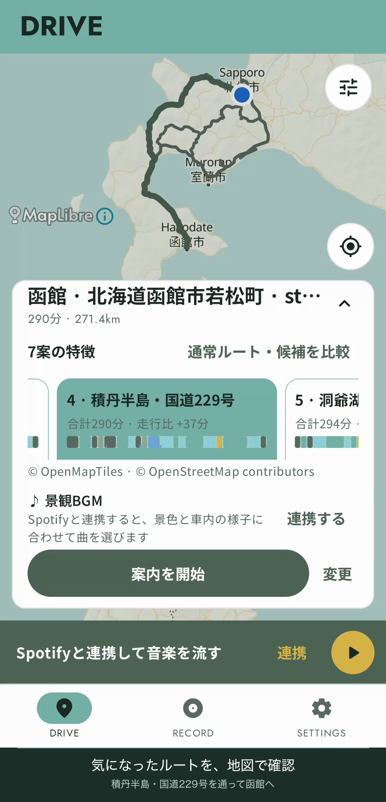
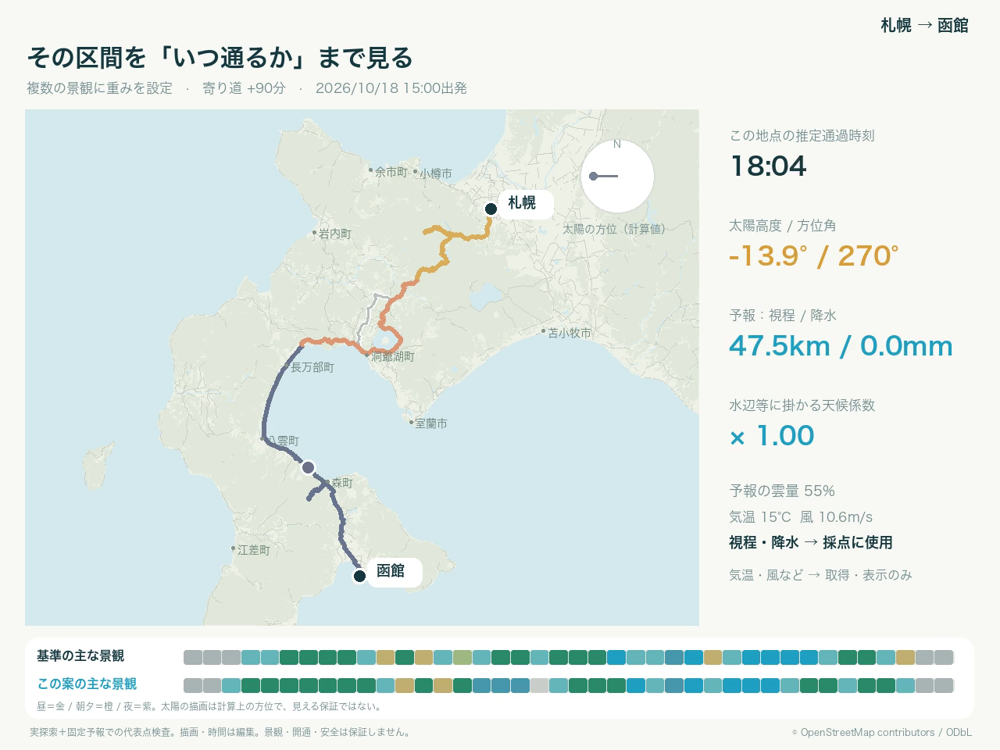

# 動画

## アプリの操作PV

札幌から函館駅へ。目的地検索、景観の優先度と寄り道上限の調整、ルート探索、候補の比較までを収録しています。
通常ルートとの差分、景観・天気・太陽の変化を確認し、最後に積丹半島の候補を地図で選びます。

Androidエミュレーターの実画面を使った約2分の縦型動画です。音声はありません。
探索が終了してから比較しています。待ち時間は早送り・一部カットしています。

## 探索の可視化

[札幌→函館の多要因探索](media/sapporo-hakodate-factors/sapporo-hakodate-factors.mp4)

実際の道路・探索結果・検索時の固定予報を使った可視化です。海・森・湖・川・谷などを順に重ね、通過時刻・太陽・天気による補正、加点・減点、最終候補の違いを示します。
124秒、1280×960、24fps、音声なし。画面録画・実車映像ではなく、描画と再生時間を編集しています。

### 記録条件

- 出発：札幌 `(43.061, 141.354)`、到着：函館 `(41.7687, 140.7288)`
- 出発日時：2026-10-18 15:00 JST、追加走行時間：90分まで
- 海28%、森林18%、湖14%、川10%、谷8%、開けた自然8%、田園7%、市街地7%
- 景観の変化0.6、登録名道0.6、夜間補正ON、seed=0、最大6案
- 高速・有料・未舗装を許可、フェリーは禁止

80回の経路計算で6案を得た記録です。最終状態は探索上限による`limited`。動画は時間を編集しており、実際の探索速度とは異なります。

補正前後の数値は、同じデータ版と予報を使い、7経路・1,344代表点で再評価した値です。ルート全体のスコアは実探索の値を使っています。
気温・風は表示のみで、採点には使いません。この記録では朝夕の方位加点は発生していません。

### 出典と利用範囲

地図・経路は© OpenStreetMap contributors / ODbL-1.0。予報はOpen-Meteo、地形・土地被覆は国土地理院・ESA WorldCover、名道は[道路台帳](scenic-road-registry.md)の紹介資料に基づきます。[各データの利用条件](public-routing-data.md)を参照してください。
記事本文・写真・音楽は収録していません。
