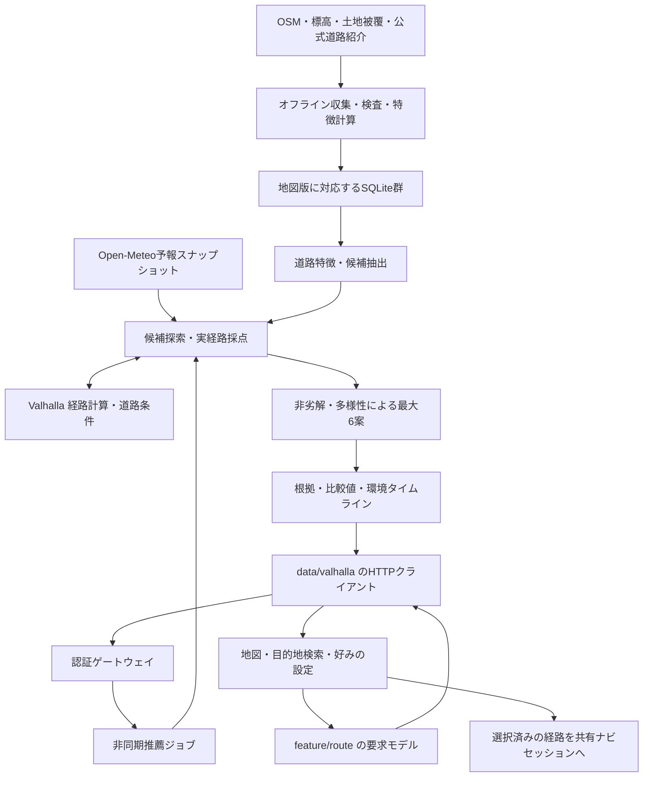

# 景観ルート推薦

北海道を対象とする景観ルート推薦のデータ構造、探索、評価式、APIをまとめる。

音楽・車内入力との接続は[アーキテクチャ](architecture.md)を参照。

## 目次

1. [何を最適化するか](#1-何を最適化するか)
2. [全体構成と責務](#2-全体構成と責務)
3. [用語・入力・時間予算](#3-用語入力時間予算)
4. [データ構造と出典](#4-データ構造と出典)
5. [道路の特徴を作る](#5-道路の特徴を作る)
6. [名道の選定・登録](#6-名道の選定登録)
7. [探索アルゴリズム](#7-探索アルゴリズム)
8. [実経路の照合と制約検査](#8-実経路の照合と制約検査)
9. [時刻・天気・方向による品質補正](#9-時刻天気方向による品質補正)
10. [ルート全体の評価式](#10-ルート全体の評価式)
11. [異なる複数候補の選抜](#11-異なる複数候補の選抜)
12. [説明・比較・景観タイムライン](#12-説明比較景観タイムライン)
13. [非同期APIと状態管理](#13-非同期apiと状態管理)
14. [案内開始・再計画](#14-案内開始再計画)
15. [速度・計算量・キャッシュ](#15-速度計算量キャッシュ)
16. [欠損・安全・セキュリティ](#16-欠損安全セキュリティ)
17. [開発の役割分担と変更方法](#17-開発の役割分担と変更方法)
18. [検証と制約](#18-検証と制約)
19. [起動・更新・障害調査](#19-起動更新障害調査)
20. [仕様変更時の確認事項](#20-仕様変更時の確認事項)

## 1. 何を最適化するか

通常のナビが「行き先まで移動する効率」を中心に扱うのに対し、旅れこは「許容できる遠回りの中で、走る時間そのものを楽しめる道」を探す。

例として、通常の経路が3時間、寄り道上限が1時間30分なら、走行4時間30分までの範囲で、海・森・湖・川・渓谷などの好み、景観の連続、変化、名道、運転負荷を比較する。休憩の滞在時間は走行時間と別に数える。

### 1.1 設計の核

- 地点だけでなく、実際に通る道路小区間へ景観特徴を持たせる。
- 良い景観が長く続く価値と、景観が変わる価値を別に評価する。
- 長く走るほど無制限に得点が増えないよう、満足に頭打ちを設ける。
- 同じ道路の往復で景観・名道の報酬を稼げないようにする。
- 出典付きの登録名道と、地形等から見つけた未登録の探索候補を分ける。
- 一つの最高点だけでなく、時間と体験の違いが分かる最大6案を返す。
- 選抜・説明・比較・案内に同じ経路形状を使う。

### 1.2 探索方式

推薦エンジンが景観区間・通過点の組み合わせを探索し、Valhallaが走行経路を計算する。返された経路の時間予算と対象区間の通過率を検査し、数値特徴で採点する近似探索で、LLMや学習済みモデルは使わない。

## 2. 全体構成と責務



### 2.1 アプリ側

| 所有者 | 責務 | 持たせないもの |
| --- | --- | --- |
| `feature/route` | 要求・好み・候補・景観・比較の共通モデルと契約 | HTTP、SQLite、Android固有API |
| `data/valhalla` | API要求、非同期結果取得、検証・共通モデルへの変換 | 画面レイアウト、GPS取得、推薦の再採点 |
| `core/location` / `platform/android-location` | 位置の契約 / OS位置入力と精度・鮮度 | 景観の優劣判断 |
| `feature/navigation` | 案内状態・経路進捗・共有セッション | 画面ごとの独自経路選抜 |
| `platform/android-navigation` | MapLibre、Android操作画面、TTS、案内サービス | サーバーと異なる景観スコア |
| `platform/android-auto` | 車載テンプレートへの変換 | スマホと別の案内状態 |
| `feature/drive` | ナビ・音楽・車内機能の連携 | 各機能の内部アルゴリズム |

モデル・契約はKMPで共有し、地図・TTS・バックグラウンド案内はAndroid側で実装する。iOSのナビアダプターは未実装。

### 2.2 推薦サーバー側

| コンポーネント | 実装 | 責務 |
| --- | --- | --- |
| 要求・制約 | `recommendation/models.py` | 型、範囲、既定値、版 |
| データ参照 | `store.py` / `source_database.py` | 特徴統合、地図署名照合、空間候補、道路照合 |
| 地域分散 | `candidate_area.py` / `corridors.py` | タイル順、地域別候補、広域の通過ゲート |
| 探索制御 | `search.py` | ビーム、ALNS、予算、キャッシュ、有効解の保存 |
| 経路アダプター | `routing.py` | Valhalla要求と応答・道路条件検査 |
| 経路評価 | `evaluator.py` / `experience.py` | 重複除外、時間、景観、負荷、目的関数 |
| 動的環境 | `environment.py` / `landscape_quality.py` | 予報、太陽、時間・方位補正 |
| 複数案 | `portfolio.py` | 非劣解、道路重複・特徴差による選抜 |
| 説明と表示 | `evidence.py` / `route_environment.py` | 根拠台帳、表示用環境帯・候補点 |
| 実行と保存 | `jobs.py` / `server.py` | HTTP、ジョブ、revision、snapshot、案内開始・再計画 |
| 取得状況 | `data_status.py` | 接続済み・未接続・未検証を区別 |

Python側は一つのサービス内のコンポーネント分割であり、各ファイルが独立したマイクロサービスではない。

## 3. 用語・入力・時間予算

### 3.1 基本用語

| 用語 | 意味 |
| --- | --- |
| 道路サンプル | OSM由来の道路形状を評価する小区間。交差点間の完全な論理エッジと一致するとは限らない |
| `physical_id` | 地図版・OSM way・区間順・端点から作る物理区間ID。進行方向を分けず重複を検出する |
| 有向通過 | 物理区間をどちら向きに通ったか。方向別の品質・通過確認に使う |
| 景観区間 / arc | 景観条件に合う連続した道路サンプル群。公開道路名の登録単位とは別 |
| Opportunity | 探索へ投入する景観区間・通過ゲート・施設候補 |
| anchor | Valhallaへ渡す座標・通過種別・必要に応じた方位 |
| archive | 制約を満たして実評価された候補の保存集合 |
| snapshot | 要求、データ版、予報、探索設定、実装ハッシュを固定した検索根拠 |
| revision | 検索結果の更新番号。候補先行表示・古い選択の検出に使う |

地図更新で`physical_id`は変わり得る。異なる地図版へ走行履歴をそのまま適用しない。

### 3.2 入力

出発地、目的地、出発日時、モード、時間予算、景観比重、体験比重、道路条件、休憩条件、最大候補数、seedを受け取る。日時はタイムゾーン必須。数値は有限値・範囲を検査し、不正値を黙って補正しない。

通常のUIは海・森林・湖と池・川・渓谷・開けた自然・田園・市街地の8本の比重を編集できる。体験比重は景観の変化・助手席からの眺め・登録名道の優先度の3本。各UI値をAPIの0〜1へ変換し、景観比重はサーバーで合計1に正規化する。全景観0は拒否する。

内部は互換性のため`inland_water`（水辺総合）、`townscape`（魅力的な街並み）を含む10カテゴリ。市街地の建物密度`urban`と、街並みの美しさ`townscape`は別物。現行データでは後者は基本的に欠損。水辺総合と湖・川へ同時に重みを与える外部要求は可能だが、相関した特徴を別々に評価することになる。UIは8カテゴリを使い、この重複を避ける。

プリセットは景観比重をまとめて設定するショートカットである。探索アルゴリズムを切り替えるモードではない。バーを動かすだけでは検索せず、適用・検索時に要求を送る。

### 3.3 目的地ありの時間制約

記号を次のように定める。

| 記号 | 内容 |
| --- | --- |
| `T0` | 同じ道路条件でValhallaが返す基準経路の走行時間 |
| `B` | 許容する追加走行時間。API範囲0〜21,600秒（6時間） |
| `Td` | 候補経路の走行時間 |
| `Ts` | 休憩の滞在時間合計 |
| `Tmax` | 任意の旅行総時間上限 |

必須条件は`Td ≤ T0 + B`。総時間を指定した場合は、さらに`Td + Ts ≤ Tmax`を満たす。再計画等で残り走行時間上限を指定した場合は、それも満たす。

目的地が遠いことを理由に120分で打ち切る仕様ではない。`T0=3時間、B=1.5時間`なら走行4.5時間までが対象。30分休む場合は総所要5時間になるため、総時間上限4.5時間を別途指定していれば不可となる。

UIの「最短経路からの寄り道」は、この基準経路との比較を指す。`T0`はValhallaの自動車コストで選ばれた経路の時間で、純粋な最小走行時間とは異なる。現況渋滞は含まない。

#### 走行速度の補完

`hokkaido-roads-v1`を道路タイル構築時に適用する。速度タグがない道路にだけ、次の推定走行速度を設定する。交通実績から校正した値ではなく、初期の補完値。

| OSM道路分類 | km/h |
| --- | ---: |
| motorway | 90 |
| trunk | 50 |
| primary | 45 |
| secondary | 40 |
| tertiary | 35 |
| unclassified | 30 |
| residential | 25 |
| service | 15 |
| living_street | 10 |

接続路は25〜40km/h。路面補正と交差点の通過時間はValhallaが計算する。市街地の幹線を建物密度から追加補正する処理や、実交通データは未導入。

`maxspeed`・方向別速度・推奨速度・実勢速度・条件付き速度がある道路と、フェリー・林道は標準処理を維持する。補完値は内部の`average_speed`へ設定し、制限速度は作らない。Valhalla内ではタグ由来速度として扱われるため、`speed_type`だけで実測・OSM登録済みとは判定しない。

基準経路・候補探索・寄り道制約・ETA・環境評価は同じタイルの時間を使う。アプリ側で時間を一律に引き延ばさない。タイル生成記録にはプロファイル名とLuaのハッシュを保存し、探索snapshotにも対応する生成記録を含める。
速度プロファイルやタイルを変更した場合、旧セッションの再計画は`routing_version_changed`で拒否する。新しく検索して時間予算を計算し直す。

### 3.4 周遊と休憩

周遊は目的地を出発地に戻し、総時間上限を必須とする。距離0の基準経路へ寄り道上限だけを足すのではなく、総時間予算で探索する。

休憩は希望回数0〜3、滞在60〜7,200秒、必須施設ID、設備、連続走行時間の目安を扱う。希望回数と必須施設は異なる。希望回数不足は警告と適合点へ反映し、必須施設の未到達・時間未確認などは不成立とする。

収集したOSM施設31,297レコードは、そのまま休憩候補にはしない。入口等を持つ別の補完施設データが必要で、POI台帳と休憩用`Facility`は異なる。

## 4. データ構造と出典

### 4.1 静的データは検索前に生成する

```text
region.osm.pbf
 ├─ Valhalla道路タイル            → 走行経路計算
 ├─ scenic-hokkaido.sqlite        → 道路小区間・基本特徴・空間索引
 ├─ landscapes-hokkaido-v4.sqlite → 湖・川・水域・谷・田園の近接
 └─ context-hokkaido-v1.sqlite    → 道路追加属性・未検証POI

公式の道路紹介 + OSM対応付け
 └─ road-recommendations-research-20261018-v7.sqlite → 本登録道路・区間対応

国土地理院DEM → terrain-hokkaido-v1.sqlite        → 標高・谷・地形遮蔽
ESA WorldCover → landcover-hokkaido-v3.sqlite      → 森林等の補完
```

本体カタログを変えずに追加DB（sidecar）を付ける。地図版・カタログ署名・スキーマ版を検査し、不一致を無視して結合しない。実行時は読み取り専用で参照する。DBファイルがあるだけでは、起動設定に接続済みとは限らない。

原データのURL・取得日・SHA-256・観測年・生成版・出典を保存する。ESAデータの観測年は2021年。

### 4.2 北海道データの規模

| 対象 | 実績 | 読み方 |
| --- | ---: | --- |
| 道路サンプル | 2,620,431件 | 道路の本数ではない |
| 追加近接特徴があるサンプル | 2,580,817件 | 特徴の正解率ではない |
| 地表標高を取得できたサンプル | 2,620,295件 | 橋の道路面標高ではない |
| 全8方位の地形計算ができたサンプル | 2,381,104件 | 1kmより遠い遮蔽物は含まない |
| 谷の地形推定値0.45以上 | 77,381件 | 独立した渓谷の数ではない |
| ESA分類を付与できたサンプル | 2,620,431件 | 2021年の土地被覆分類 |
| OSM POI | 31,297レコード | node/wayの重複があり、relationsは対象外 |
| 追加道路属性 | 12,814 way | 全道路で各属性が揃うわけではない |
| 本登録道路 | 48件 | 秀逸15・絶景12・おすすめ11・景観10。別に保留11件。[道路台帳](scenic-road-registry.md) |

データの版・再生成・利用条件・元資料リンクは[公開データ仕様](public-routing-data.md)、道路の実名は[全道路台帳](scenic-road-registry.md)を参照。

## 5. 道路の特徴を作る

### 5.1 基本特徴と近接

各道路に0〜1の特徴と欠損状態を持たせる。森林・自然・海の基本値は既存カタログを使い、開けた自然は基本自然値から森林を差し引く。`urban`の採点用特徴は`clip(建物被覆率 / 0.15)`とし、表示用の元の被覆率も保持する。

北海道の基本カタログは`import_region.py`で生成する。OSMの形状を最大100mの道路小区間へ分け、その中点で海岸2km以内の距離減衰`exp(−d/300m)`、森林100m・自然500m・建物100mの周囲面積率を計算する。対象は自動車向けの主要道路・一般道等で、私有・林業等のアクセス制限を除外する。OSMに存在する全ての線を無条件に収録したものではない。

追加近接DBは道路小区間の中点から対象地物までの距離`d`を求め、`exp(-d / σ)`へ変換する。`σ`は谷400m、田園150m、その他300m。近接検索の上限は海2,000m、その他900m。簡易投影で近似した距離であり、視線・入口までの走行距離ではない。

湖・池・貯水池、川・運河・沢、種別不明の水域を区別する。`inland_water`は湖・川・種別不明水域の最大値で、足し合わせない。OSMの沢を含む`river`を「常に大河の眺望」とは解釈しない。

トンネル内は景観特徴を0にする。登録道路の形状からトンネルを削るのではなく、道路台帳と走行時の景観評価を分ける。

### 5.2 地形

国土地理院DEM10BのPNGを符号付きcmとして復号し、無効画素を欠損とする。zoom11は北海道付近で約50〜60m相当。周囲8方位×250・500・1,000mから地形のせり上がり角と開放性を近似する。

谷の代理指標には、向かい合う地形の壁と、直交方向の抜けを使う。単なる高標高、平地、全方向が閉じた地形をそのまま高評価しない。OSMの谷近接とDEMの谷推定は最大値で統合する。

地形の地平線角を45度ごとの8方向に保存し、太陽方位の隣接2方向を補間する。太陽高度が`max(0, 地平線角)`を超える場合に、地形上は隠れていないとする。建物・植生・遠方の山・大気差まで検査した視線解析ではない。

道路勾配は、補完データ・OSMタグ・条件を満たすDEM推定の順に使う。橋・トンネルへ地表勾配は代入しない。DEMの解像度不足で推定勾配は未採用。OSMの数値勾配は12wayにある。

### 5.3 衛星土地被覆

ESA WorldCover 2021 v200の7タイルを登録不要の公開配信から取得した。提供元の縮小層を最近傍参照し、北海道付近で約27〜37m相当。元製品の10mをそのまま全評価点で使う設計ではない。

森林は周囲100m、開けた自然・田園は500mを各13点でサンプリングする。有効値80%未満は欠損。統合は次のとおり。

```text
残余 = max(0, 1 − OSM建物被覆率 − 他用途による抑制)
補完 = 0.75 × 衛星の対象分類割合 × 残余
特徴 = max(OSM等の既存特徴, 補完)
```

森林補完の「他用途による抑制」は0、開けた自然・田園補完では基本カタログの森林率を使う。明示的な補完値がある場合はその指定を優先する。

水域分類だけから海・湖・川を割り振らない。裸地・建物・2021年の雪氷を、美しい自然・現在の積雪として加点しない。古い観測の補完であり、現在の伐採・造成を検知したとは扱わない。

## 6. 名道の選定・登録

### 6.1 本登録と推定候補は別

本登録には、公式・自治体・観光団体・道路管理者等による「その道路自体の紹介」を必須とする。周囲の観光地だけの紹介は足りない。対象範囲、道路名、OSMの路線名・番号、出典、確認メモ、保留理由を人が審査する。

海岸・地形・土地被覆から良い道を見つけても、本登録のランクは付けない。未登録でも景観評価によってルートに採用できる。「登録道路だけを通る」システムではない。

日帰り・宿泊モデルは旅行商品の日程であり、道路の推薦ランクや登録IDには使わない。

### 6.2 4ランク

| ランク | 表示 | 重み | 根拠 |
| --- | --- | ---: | --- |
| `signature` | 秀逸な道 | 1.0 | 公式認定の対象区間 |
| `panorama` | 絶景ロード | 0.6 | 道路紹介の一次資料＋独立した紹介等の裏づけ |
| `recommended` | おすすめロード | 0.3 | 道路紹介の一次資料に基づく編集推薦 |
| `scenic` | 景観ロード | 0.1 | 道路紹介の一次資料を持つ本登録道路 |

秀逸な道以外は旅れこ独自の編集区分。おすすめ・景観の分級は手動で、自動的な客観順位ではない。適格な道路口コミを絶景の補助に使う場合の件数・評点ルールは[登録基準](scenic-road-registry-policy.md)に明記する。口コミだけでは本登録できない。

### 6.3 まばらな線を登録しないための検査

一般道路は名称・路線番号と対象範囲を照合し、道路網上の接続成分を検査する。地理的特徴が弱い部分を切り落として、魅力的な点だけを一つの道路名に束ねない。分岐や上下線は形状部分として保持する。明らかな過少・過大照合、分断、範囲未確定は保留にする。

秀逸な道は公式公開線形への対応を使う。距離30m以内、方向差30度以内、小区間80%以上の重なり、公開線25mサンプルで対応率90%以上を検査する。認定自体が複数路線の区間群の場合があるため、一律に一本の線だとは言い換えない。

資料本文と照合形状を審査し、生成DBには`active/pending`、`membership`、順序付きの`road_part`、出典を分けて保存する。

## 7. 探索アルゴリズム

### 7.1 全体の手順

```text
要求を検証し、地図・追加DB・予報をスナップショット化
基準経路T0を計算し、成立する候補があれば先に公開
Valhallaが返した標準代替案も検査
時間予算内に入り得る領域から、地域分散した景観区間を抽出
広域通過ゲートから別回廊の初期解を作る
複数の好みプロファイルでビーム探索
ALNSで削除・挿入・置換・反転等を試す
実経路・制約・対象区間通過を検査した有効解を保存
非劣解と多様性から最大6案を選ぶ
同じ経路から根拠・比較・表示データを生成
```

探索終了前でも、検証済みの有効解があれば途中結果を返す。途中候補は最終候補と異なり得る。

### 7.2 候補領域と区間抽出

1. `T0+B`等の有効な時間上限と、意図的に緩い400km/hの上界から探索領域を作り、カタログ範囲へ切る。
2. 領域を0.2度タイルへ分け、基準経路の各進行段階へ分散した順で読む。近場だけで時間を使い切る偏りを抑える。
3. 好みがあるカテゴリの特徴0.45以上、または登録名道をSQLで抽出する。地形・衛星分類も候補足切りに接続する。
4. 同じwayで区間順が連続する道路をつなぐ。通常は特徴0.65以上で開始、継続中は0.45以上を許す。トンネル等で切る。
5. 通常300m、登録道路を含む場合30m以上の区間を候補化する。長い列は最大100道路サンプルごとに分ける。
6. 約500mごとの通過点と、通過確認用の物理区間列・補修点を持たせる。
7. 起点→候補→終点の直線距離を400km/hで割っても予算を超える候補を落とす。
8. 進行方向の地域・横方向約20kmの帯・カテゴリ別に候補を保ち、景観区間を最大100件選ぶ。入口が400m未満で近い候補は抑える。

400km/hは実際の走行速度でも通常の所要時間予測でもなく、直線距離で早く落としすぎないための楽観的な足切りである。道路上の時間は後段で必ずValhallaから求める。現行の主処理は全候補間の時間行列を事前計算する方式ではない。

候補抽出は最大10秒目安で、残時間によって短縮する。登録名道をSQLの抽出対象に残し、時間・道路条件と採点で採否を決める。

### 7.3 広域回廊の初期解

札幌→函館のような長距離では、基準経路近くの区間を一つずつ挿すだけだと、日本海側のように大きく離れた回廊へ移れない。

そこで候補を出発地→目的地の進行度と横方向の帯に分け、地域代表を選ぶ。地理的に離れた代表を優先して、単独ゲートを先に試し、続いて同じ帯の複数ゲートを進行順につなぐ。複数ゲート列は最大6地点、初期解は最大24組。

この通過ゲートは「指定した景観道路を全線通った」という証拠ではない。実経路を採点して採否を決める。海沿いモードでも、予算・接続・候補打ち切り・多様性の条件により、日本海側が必ず出るとは限らない。

### 7.4 ビーム探索

ビーム探索は、各段階で良い途中解を複数残し、候補区間を追加する方法。

- 元の好みに加えて最大6プロファイルを使用。追加プロファイルは各比重を0.8〜1.2倍して再正規化する。
- 景観区間の正順・逆順、挿入位置を試し、概算価値と移動負担で試す順を決める。
- 実評価後は最大24途中解、既定深さ3を残す。
- 同じ物理道路の重複率0.97以上の途中解を抑える。
- 探索時間と呼出し予算を使い切らず、後段ALNSの余地を残す。

概算値は試行順のためで、結果の正式スコアではない。

### 7.5 ALNSによる改善

ALNSは、現在の案の一部を崩して組み直す近似探索。最大300反復で、次の操作を選ぶ。

| 操作 | 内容 |
| --- | --- |
| remove | 任意区間を削る |
| cluster | 近い範囲の区間をまとめて外し、組み直す |
| replace | 区間を別候補へ置き換える |
| insert | 候補を挿入する |
| reverse | 対象景観区間の通過方向を反転する |
| regret | 挿入位置の選択肢が少ない候補を優先する |
| rest | 休憩候補を挿入する |

必須施設は任意削除の対象にしない。改善した案は採用し、一時的な悪化も`exp(スコア差 / 温度)`の確率で許して局所解から抜ける。温度は0.05から毎反復0.995倍。操作の重みは25反復ごとに成果に応じて更新する。

各操作は計算量を抑えた近似実装とする。

## 8. 実経路の照合と制約検査

### 8.1 Valhallaへの要求

全通過点列を一度にValhallaへ渡す。別々に計算した区間を単純連結して右左折制限を失うことを避ける。通常の通過は`through`、出発・到着・施設立ち寄りは`break`を使う。

地点の検索半径30m、探索打ち切り100m、方位指定があれば許容45度。通常の起終点だけの要求では標準代替経路を最大2本求める。料金・高速・フェリーの好み値だけに頼らず、応答に該当属性があれば禁止条件への違反として除外する。

### 8.2 景観評価用の道路照合

返された形状を既定50m間隔でサンプリングし、道路距離20m以内、道路軸の角度差40度以内、一方通行の向きが適合するものへ対応づける。最寄り距離と角度差で選ぶ。

これは景観特徴を対応づけるための独自照合であり、Valhalla内部の走行グラフそのものを完全復元する処理ではない。照合できないことだけで、走行不能とは断定しない。

ただし「未舗装禁止」で路面が不明、または「確認済み幅員を要求」で幅員不明・4m未満の場合は、要求した厳格条件を証明できないため不成立とする。景観照合率に一律の90%を要求する仕様ではない。

### 8.3 対象区間を実際に通ったか

明示した景観arcは、対象物理区間を正しい向きで90%以上通ったか確認する。不足時は内部の通過点を順序付きで補い、最大2回の補修試行を行う。確認できなければ`arc_coverage`で除外する。

ここでの90%は「狙った景観区間の通過率」。経路全体の景観データ照合率とは別の指標。

### 8.4 制約と休憩

走行・総時間・残り時間、必須施設、道路条件を検査する。施設は入口から35m以内のleg終端へ到達し、対応する形状位置が順序通りであることを確認する。

滞在開始から終了まで営業時間窓内か、必要設備が揃うかを検査する。必須施設で営業時間を証明できなければ不成立。任意施設の未確認は低信頼の説明にする。営業時間文字列の全面的な解釈や待機時間の最適化はなく、現行の待機時間は0。

## 9. 時刻・天気・方向による品質補正

### 9.1 区間ごとの通過時刻

候補ごとのValhalla maneuverの距離・時間から、その経路自身の通過時計を補間する。すでに通る休憩の滞在時間を加算し、出発日時に足す。他の候補の時計を流用しない。maneuver時計が使えない場合のみ、経路距離比で補間する。

予報は検索開始時のスナップショットで固定する。起終点とその間の最大7地点で取得し、取得6秒目安・キャッシュ15分・適用範囲50kmとする。起終点を結ぶ線から大きく迂回した区間は、予報範囲外になる場合がある。

### 9.2 近いことと見えること

- 海は、方向別の可視性補完値があれば使い、なければ近接特徴を0.5倍する。
- 湖・川・水辺総合・谷は、可視性補完値があれば使い、なければ開放性から0.42〜0.7程度に弱める。開放性も欠損なら0.7。
- 助手席側・前方ではない海・湖・川は、助手席比重に応じて最大20%弱める。
- 地図上に海があることを、実際に車窓から見える証明へ置き換えない。

`visibility_verified`は可視性の補完値の有無を示す内部フラグ。現地確認の有無は表さない。

### 9.3 天候と昼夜

海・水辺総合・湖・川・谷・開けた自然・田園は、予報があるとき次で補正する。

```text
天候係数 = clip(視程 / 15,000m) × exp(−降水量 / 5)
夜間係数 = clip((太陽高度 + 6度) / 12度)
```

夜間補正ONなら上記カテゴリへ夜間係数を掛ける。OFFは昼夜による減衰だけを止め、天候・道路制約を止めない。現行の森林・市街地・街並みはこの昼夜・天候係数の対象外。

朝夕の水辺への方位加点は、太陽高度−6〜6度、雲量40%以下、降水0.1未満、視程1,000m以上、地形上の太陽可視、対象水域の方向が揃った場合に最大1.15倍。地形欠損では加点せず、夜間補正OFFでも夜に朝焼けを作らない。

気温・湿度・風・突風・雪・日射等も取得・保存・表示するが、全てを直接スコア化するわけではない。裏づけなく「強風だから安全度何点」「低温だから路面凍結」と変換しない。

## 10. ルート全体の評価式

以下の係数は現行の調整値であり、実走評価で最適化された普遍的な正解ではない。`clip(x)`は0〜1への切り詰め。

### 10.1 同じ道の重複を除く

物理区間上に通過した範囲を記録し、再通過の重複部分を和集合で除く。カテゴリごとの有効距離は、各位置で補正後の品質の最大値を距離積分する。

```text
Ek = Σ物理区間 ∫ max(その位置を通る各回の品質qk) dx
```

高品質な道1kmを品質0.5で通ると、有効距離は約0.5km。これは「海に近い道の実距離」と異なる。履歴利用に明示同意があり既走行IDが渡された場合、その区間の景観品質を0にして新規体験を優先する。

### 10.2 景観の質Qと連続性C

`wk`は正規化した好み、`L`は経路全長。基準時間に15m/sを掛けた参考距離を`Lref`とする。周遊では総時間上限を使う。15m/sは実経路のETAではなく、効用の尺度を長距離に合わせるための値。

```text
Sk = max(カテゴリ初期尺度, min(120,000m, 0.18 × Lref))
Q = 0.75 × Σ wk × (1 − exp(−Ek / Sk))
  + 0.25 × Σ wk × min(1, Ek / L)
```

初期尺度は海5km、森林4km、水辺総合3km、開けた自然4km、田園4km、街並み・湖・川・谷・市街地は各3km。同じ尺度を全候補に使い、候補集合の最小・最大で正規化しない。

品質0.45以上で、新規に通る部分が十分ある区間の連続距離を取り、カテゴリごとに長い上位2区間を使う。1位を1倍、2位を0.4倍として、`Sc=max(3km,min(30km,0.04×Lref))`で飽和させる。

```text
C = Σ wk × (1 − exp(−(連続1位 + 0.4 × 連続2位) / Sc))
```

長い海沿いを無限に延ばしても加点は緩やかになる。一方で短い景観が点在する道と、まとまって続く道を区別できる。

### 10.3 変化V・立ち寄りP・名道R

`V`は300m以上続く主要景観間の遷移と、森林から海へ開ける推定イベントを飽和させ、景観の変化比重を掛けた値。細かな分類のちらつきをそのまま全て報酬にしない。

`P`は補完データ上の認定区間のユニーク距離と休憩適合点の重み付き合成。認定区間は3km尺度で飽和する。休憩は希望回数に対する設備適合・連続走行間隔で評価する。必須施設はこれとは別に制約検査する。

本登録4ランクの報酬は独立した`R`成分。物理位置ごとに最上位ランクだけを計上し、再通過を除く。ランクごとのユニーク距離を`Mr`として、

```text
登録名道価値 = maxランク [ランク重み × (1 − exp(−Mr / 3,000m))]
R係数 = 0.12 + 0.18 × 登録名道の優先度
```

4ランクの報酬を全部足して稼ぐ設計ではない。優先度0でも基本係数0.12は残る。バー0は本登録道路の禁止や基本報酬の完全無効ではない。旧補完データの認定区間Pと、本登録ランクRの両方が設定された場合には相関した報酬が残るため、同じ区間を二系統へ追加する変更は評価テストが必要。

### 10.4 時間・負荷・重複・不確実性

| 記号 | 内容 |
| --- | --- |
| `PT` | 追加走行時間の予算比80%＋必須分を除く滞在時間の負担20%。各項をclip |
| `Lload` | 幅員・路面・勾配・曲率の距離平均75%＋複雑な曲がりの密度25% |
| `H` | 重複距離の比率80%＋Uターン20% |
| `U` | 距離加重の信頼度不足と、希望カテゴリの欠損率 |

追加走行時間の分母は`max(900秒,B)`、任意滞在の分母は1,800秒。負荷の代理指標は狭さ0.4、粗さ0.25、勾配0.2、曲率0.15で合成し、不明は中立ではなく負担0.5として扱う。低い太陽へ向かう条件では負荷を少し上げるが、これは安全度の測定ではない。

重複距離は経路全長の25%で距離側の減点が飽和し、Uターン側は2回で飽和する。既定の特徴信頼度0.3、明示補完がある場合0.6は経験的な初期値であり、校正された確率ではない。

### 10.5 最終スコア

```text
J = Q + 0.15C + 0.10V + 0.15P + R係数 × 登録名道価値
    − 0.25PT − 0.20Lload − 0.20H − 0.10U
```

制約違反を点数で相殺しない。まず不成立候補を除き、残りをこの式と複数案選抜で比べる。スコアは百分率・満足確率・安全点ではない。

### 10.6 小さな計算例

説明用に、1kmの道路が海の近接特徴0.8を持ち、晴天の日中に通るとする。

1. 可視性は未確認なので0.5倍し、海の体験品質は0.4になる。方位補正・朝夕加点はないものとする。
2. 海の有効距離への寄与は`1,000m × 0.4 = 400m`。一方、元の海特徴は0.5以上なので海近接距離には1kmが入る。
3. 主要カテゴリの海表示は元特徴で判断するため、海が帯に出ていても「海が見えることを確認した」とは言わない。
4. 補正後品質0.4は連続性の閾値0.45未満なので、この条件だけでは「海の体験品質が高い連続1km」の加点にはならない。
5. 同じ区間を同条件で往復しても、有効距離は800mへ倍増しない。実際の走行時間・重複負担は増える。

このように、地理表示・体験評価・重複・時間を別々に扱う。見た目の帯の長さを、そのままルート点数へ変換する設計ではない。

## 11. 異なる複数候補の選抜

### 11.1 非劣解

時間が長く、負荷も高く、重視する景観や名道・休憩適合も良くない候補は除く。比較軸は総時間・運転負荷・名道価値、比重0.1以上のカテゴリの有効距離、希望時の休憩適合。

微小差を過大評価しないため、時間30秒、負荷・名道等0.01、景観100mを許容幅にする。この許容幅は厳密な数学的Pareto支配と異なるため、候補が全て落ちる場合は最高スコアを残す。

### 11.2 道路と特徴の違い

物理区間長に基づく重複率を、重み付きJaccardとして計算する。

```text
O(A,B) = Σ区間 min(Aの通過長, Bの通過長) / Σ区間 max(Aの通過長, Bの通過長)
分離度 = 0.7 × (1 − O) + 0.3 × 特徴差
```

特徴差は総時間・負荷・名道・重視カテゴリの有効距離の差を固定尺度で比較する。分離度0.20以上を採用条件にする。同じ道路でも通過時間・特徴が異なることはあるが、ラベルだけ違う候補を水増ししない。

### 11.3 選ぶ順番

1. 好みへの体験価値が高い案を選ぶ。体験価値は景観距離65%・比率20%・連続15%の合成から重複・負荷を引いた、選抜用の別指標。
2. スコアと既選択案との違いを使って、バランス案を選ぶ。
3. 分離条件を満たす場合、最も総時間の短い案を選ぶ。
4. 残りは品質70%・分離度30%で、要求された最大数まで補う。

「景観重視・バランス・時間重視」は3本の固定アルゴリズムではなく、同じ有効候補集合から異なる役割で選ぶ方法。4本目以降も道路名・実測特徴・比較値を表示し、共通の「別の景観を楽しむ」という役割名だけに頼らない。

基準経路は比較対象として別に保持する。基準が他候補に劣っても、比較用の線や数値を消す必要はない。条件を満たす異なる経路が少ないときは6本にしない。

## 12. 説明・比較・景観タイムライン

### 12.1 根拠台帳

説明は、採点された経路上の距離範囲・指標・出典からテンプレートで作る。架空の道路名や「必ず海が見える」といった文を自由生成しない。

各根拠には`evidence_id`、`route_id`、`revision`、`snapshot_id`、測定指標・値、経路上の距離範囲、出典ID、信頼度ラベル、評価版を持たせる。説明文はその根拠IDを参照する。

海の説明では少なくとも次の数値を区別する。

| 数値 | 意味 |
| --- | --- |
| 海近接距離 | 基本の海特徴0.5以上を通るユニーク距離。天気で海の地理自体を消さない |
| 海の有効距離 | 可視性・方向・天候・昼夜で補正した品質の距離積分 |
| 景観帯の海の長さ | 主要カテゴリとして海が選ばれた表示範囲。他カテゴリが優勢なら短くなる |

数値の差を調べるときは、元特徴・道路照合・補正・表示集約の順に確認する。

### 12.2 景観と環境の二つの表示

地理的な景観帯は、元の道路特徴から主要カテゴリを選ぶ。海特徴0.5以上には表示選択だけ1.2倍の優先を与え、海が細い区間に埋もれる問題を軽減する。実際の海特徴・採点点数は1.2倍しない。湖・川が主になれる場合は水辺総合の重複表示を抑える。

採点用には時刻等で補正した体験タイムラインを別に作り、連続性・変化の計算に使う。夜になったから地理表示の海を消す、という設計にはしない。

その下の環境帯は各候補を約500m単位、最大192区間に分け、同じ経路の通過時計で太陽・朝夕・天気・水辺・谷・街度を対応させる。長距離では区間幅が500mより大きくなる。こちらの表示用区間数と、採点用50mサンプルは別。

### 12.3 名道と見どころ

4ランクは同じ距離軸の一本のランク帯にまとめ、色と名前を併用する。タップすると距離範囲に対応する地図位置・道路名・ランク・出典へつなぐ。同じ場所の重複登録は最上位表示を基本に、根拠を失わないよう詳細で確認する。

見どころ候補は表示用環境帯から最大4点を選ぶ。景観の強さ0.5以上、開放性、朝夕の水域方向、天候を考慮し、トンネル・未照合・夜を除く。経路上で`max(1.5km,全長の8%)`以上、座標上でも1.5km以上離して偏りを抑える。

朝夕方向の表示候補は予報不明でも残すが、経路採点の朝夕加点には予報・地形を必須とする。見どころ候補は経路報酬へ戻さない。停車可否は未検証で、全候補に`stopping_verified=false`を返す。

### 12.4 比較UIの読み方

各候補と基準について、総時間、走行・滞在、追加時間、距離、カテゴリ特徴、名道、負荷、推定範囲を比較する。欠損を「0km」として良し悪しの差にしない。

カードの小さな景観帯は、それぞれの経路全長を100%にそろえる。横幅が同じでも距離・時間が同じではないため、全長・時間を併記する。時刻対応は各候補の詳細で確認する。

比較ダイアログでは「同じ距離の縮尺」（既定）と「全体を100%に」を切り替えられる。短い海の区間は主要カテゴリだけでは埋もれるため、海に近い区間を下端の青線でも示す。カテゴリ別の距離は重なることがあり、合計が経路全長になるとは限らない。

ルートカード選択ではその候補の詳細を開く。詳細内の景観区間選択は地図の強調位置だけを変え、詳細を勝手に閉じない。選択候補、詳細の開閉、選択区間、案内中経路を別の状態として管理する。

## 13. 非同期APIと状態管理

### 13.1 API

| メソッド・パス | 役割 |
| --- | --- |
| `POST /route-recommendations` | 202で要求IDを返し、探索開始 |
| `GET /route-recommendations/{id}?view=status` | 探索中は軽量な状態・revision取得。終端では完全結果を返す |
| `GET /route-recommendations/{id}` | 現在の候補・根拠・比較を取得 |
| `DELETE /route-recommendations/{id}` | 探索取消要求と保存結果削除 |
| `GET /route-recommendations/{id}/snapshot` | 要求・予報・データ版の根拠を取得 |
| `GET /route-recommendations/data-status` | 収集・接続・未検証の状況を取得 |
| `GET /routes/{route_id}/evidence` | 選択経路の根拠と景観帯 |
| `POST /navigation-sessions` | 経路ID・revisionを指定して案内開始を記録 |
| `POST /navigation-sessions/{id}/replan` | 残り時間と既走行区間を考慮した再提案 |

IDはAPIが返したものを使い、順序や表示名で候補を識別しない。端末は生のValhalla JSONを画面へ直接流さず、共通モデルへ検証変換する。

目的地あり・寄り道90分・最大6候補の要求例。出発日時は実行時に変更する。

```json
{
  "origin": {"lat": 43.0618, "lon": 141.3545},
  "destination": {"lat": 41.7687, "lon": 140.7288},
  "mode": "point_to_point",
  "departure_time": "2026-10-18T08:00:00+09:00",
  "budget": {"max_extra_driving_seconds": 5400},
  "preferences": {
    "sea": 0.6,
    "forest": 0.2,
    "lake": 0.1,
    "river": 0.1,
    "variety": 0.5,
    "passenger_view": 0.5,
    "certified_road": 0.5
  },
  "constraints": {
    "allow_tolls": true,
    "allow_highways": true,
    "allow_ferries": false,
    "allow_unpaved": true
  },
  "night_correction": true,
  "max_routes": 6,
  "seed": 42
}
```

この例の未舗装許可は、未知の路面による候補除外を避けるためAPI既定値を明示したもの。ユーザーが未舗装禁止を選んだ場合はfalseを送り、不明な路面も除外され得ることを説明する。

### 13.2 状態

```text
queued → processing → improving → complete または limited
                     └─────────→ failed / infeasible
```

`complete`は設定した探索手順が終了した状態で、厳密最適解の証明ではない。`limited`は時間・候補走査等の制限で打ち切った状態。`infeasible`も、探索した候補とデータの中で成立しなかった意味であり、現実に走れる全経路が存在しない証明ではない。

検索結果全体のrevisionは公開ごとに増える。一方、同じ`route_id`の経路データは不変として保存し、現行の経路自身のrevisionは1。検索全体のrevisionと経路のrevisionを取り違えて案内開始へ渡さない。

改善処理が例外で停止し、先行候補がある場合は`limited`と`improvement_failed`を返して候補を残す。正常打ち切りと内部障害を同じ成功として扱わない。現在のAndroidは終端statusから候補を表示するため、障害の詳細な切り分けはAPIの`error/search`も確認する。

### 13.3 端末とサーバーのライフサイクル

端末は2秒ごとに状態を確認し、`improving`のrevisionが変わった時だけ完全候補を取得・表示する。全体待機は125秒。JSON変換は計算用ディスパッチャーへ移す。取消時は最大3秒の削除要求を試みるが、取消応答を永久に待たない。

サーバーは現行で同時探索1件。キュー枠が取れなければ429 `queue_full`を返す。大量利用向けの分散キューはない。ジョブ保存は既定TTL1時間・最大64件。再起動で動作中だったジョブは復元継続せず、候補があればlimited、なければfailedとして扱う。

## 14. 案内開始・再計画

Androidの案内は選択済みの`RoutePlan`を共有ナビセッションへ渡し、その形状で開始する。表示用の通過点だけから別経路を再生成して、提案と異なる道を案内しない。

`POST /navigation-sessions`は経路IDとrevisionを確認し、サーバー側に選択を記録する。Androidのローカル案内セッションとは別で、アプリからの呼び出しは未接続。

再計画APIは、現在位置・経過総時間・経過走行時間・同意付き既走行IDを受け取る。元の予算から消費済み分を引き、残りを新しい要求にする。経過時間や既走行履歴を巻き戻して予算を増やさない。地図版の変更時は継続再計画を拒否する。

再計画APIは提案までで、返却値は`selection_required=true`。現在の案内中ルートを自動で差し替えない。Androidからこのサーバーセッションを作り、再計画APIを自動利用する連携、および天気・会話・気分のあらゆる変化から自動発火する統合制御は未実装。音声・画像入力を接続する際も、入力取得、推論結果、再計画の判断を分離する。

## 15. 速度・計算量・キャッシュ

### 15.1 主な既定上限

| 項目 | 既定値 |
| --- | ---: |
| 景観区間候補 | 100 |
| 補完施設候補 | 30 |
| 回廊初期解 | 24 |
| ビーム幅 / 深さ / 好みプロファイル | 24 / 3 / 6 |
| ALNS反復 | 300 |
| 経路呼出し・実評価 | 各200を上限とする共通停止判定 |
| 探索時間 | 90秒目安 |
| 候補区間の通過確認 | 90%以上 |
| 応答候補 | 要求1〜6、API既定3 |
| 通過点総数 | 126以下 |
| 経路形状 | 60,000点以下・経路1,000km以下 |

停止判定は`max(呼出し数,実評価数)<200`。時間は処理単位の境目で確認するため、進行中の計算や応答生成により90秒を超える場合がある。

### 15.2 再計算を減らす設計

- SQL空間索引と追加DBのJOINで、必要な道路だけ読む。
- 道路特徴・way属性・位置と方位の照合を検索内で再利用する。
- 経路形状の累積距離・曲率、線分のサンプルと方位をキャッシュする。
- 同じ通過点列・道路条件・地図版の経路要求は成功・不成立とも検索内キャッシュを使う。
- 同一候補の環境表示データを応答生成で再利用する。
- DEM・衛星画像を検索中に取得・解析しない。
- 軽量ポーリングとrevisionにより、大きい応答の毎回転送を避ける。

キャッシュは件数上限を設け、検索内で再利用する。時間で探索を打ち切るため、キャッシュの有無によって探索範囲と候補が変わる場合がある。

### 15.3 計算量の見方

景観評価は経路長に比例したサンプル数に依存し、空間照合・特徴取得・重複範囲積分を行う。候補列の全組み合わせは指数的になるため、最大候補数・ビーム・反復・時間で抑える。最終非劣解判定は有効候補数に対して二乗の比較を含む。

大きな完全応答、最終直列化、端末での描画も計算時間に影響する。候補先行表示は総計算時間を減らすものではなく、待ち時間を分割する仕組みである。

## 16. 欠損・安全・セキュリティ

### 16.1 欠損のルール

未取得は`None/null`、取得済みで該当特徴がない場合は0を使う。採点上は欠損へ正の報酬を与えず、別途カテゴリ欠損率と好み加重のデータ被覆率を返す。降雪・積雪の欠損を0、欠損DEMを標高0、未知の通行規制を開通へ変換しない。

`data-status`はデータの読込・設定・検証状況を返す。値の意味は[公開データ仕様](public-routing-data.md#データ状況api)を参照。経路検索のstatusとは別に扱う。

### 16.2 安全に関する境界

- Valhalla・OSMで扱う道路条件と、公式の実況規制を分ける。現地の標識・規制を優先する。
- 条件付きアクセス、季節性、除雪不足、浅瀬等のOSMタグは注意へ反映するが、全条件を解釈済みとはしない。
- 運転負荷は代理指標であり、事故確率や道路の安全性ではない。
- 施設代表点を入口、景観候補点を停車可能地点として扱わない。
- 気温・地上積雪・風から車両や路面の安全を断定しない。

### 16.3 接続と保存

外部公開は認証ゲートウェイ経由とし、Valhalla・推薦内部サービスを直接公開しない。Cloudflare Tunnelは到達経路を提供するもので、トークン認証の代替ではない。端末のトークンはAndroid Keystoreを使う保存実装で管理し、ログ・文書・リポジトリへ実値を載せない。

認証は共有トークン方式で、利用者別のアクセス分離は未実装。検索には位置・日時が含まれ、履歴利用は明示同意を必要とする。長期の位置履歴保存は既定で無効。

## 17. 開発の役割分担と変更方法

| 開発担当 | 主な範囲 | 契約・成果物 | 最低限の確認 |
| --- | --- | --- | --- |
| データ収集・地理 | `import_*.py`、`gsi_dem.py` | 署名付きSQLite、出典、欠損・単位 | 原データ一致、nodata、解像度、再生成 |
| 道路編集・審査 | 原稿JSON、登録・形状検査 | 本登録/保留、根拠、連続形状 | 道路自体の紹介、対象範囲、誤照合 |
| 探索 | 候補・回廊・ビーム・ALNS | 制約付き有効解集合、診断 | 地域偏り、予算、呼出し数、多様性 |
| 評価・環境 | 品質補正・効用・予報・太陽 | components、metrics、版 | 重複不正、単位、欠損、単調性 |
| API・運用 | サーバー・ジョブ・保存・Gateway | status/revision/snapshot | 取消、再起動、認証、負荷 |
| KMP契約 | `feature/route` / `data/valhalla` | 要求・応答・検証・状態通知 | 互換性、上限、古い結果の混入 |
| Android/車載UI | 地図・比較・詳細・案内 | 同一候補の分かりやすい表現 | タップ対応、欠損、長文、ライフサイクル |

新カテゴリを追加するときは、データ・`CATEGORIES`・飽和尺度・欠損・SQL足切り・評価・選抜・根拠・共通モデル・UI・テストを一組で変更する。表示だけ追加して「探索にも使用」と記載しない。

新しい入力やAI判断は、センサー側から直接`search.py`や画面状態を書き換えず、[入力と推論の境界](architecture.md#入力と推論)に従って確信度・鮮度を持つ推論結果へ変換する。その後、再探索を行う判断と頻度制御を別コンポーネントで設ける。

データや評価結果が変わる変更は評価版を更新し、既存snapshot・保存経路を上書きしない。Kotlinモジュール境界は`verifyModuleBoundaries`で検査する。

## 18. 検証と制約

### 18.1 テストの対象

Pythonの単体テストでデータ読込・景観評価・制約・探索・予報を検査し、KMP側で要求・応答・状態更新を検査する。API統合試験では予算、根拠参照、環境表示、案内開始を確認する。実走・実機・全道路の検証はこれらとは別に行う。

### 18.2 未対応・近似

| 項目 | 現状 |
| --- | --- |
| 全道路の最適解 | 近似探索。候補・走査時間で打ち切る |
| 実際の海・湖・渓谷の眺望 | 近接・地形からの代理推定。現地正解との精度未評価 |
| 公式実況通行規制・渋滞 | 統合未完了。静的速度モデル |
| 紅葉・開花・現況の積雪景観 | 未取得 |
| 地表・勾配 | DEMは低解像度、勾配の広域採用なし |
| 施設入口・営業時間・利用可否 | OSM POI全件の検証なし。自動の休憩先に未投入 |
| 車内状況に応じる自動再探索 | 入力・推論の境界設計はあるが、実マイク等との全体統合は未完了 |
| 再現性 | snapshotは保存するが、壁時計の打ち切り・外部計算・キャッシュにより同seedでも同一出力保証なし |
| 多人数利用 | 同時探索1件。分散・テナント分離未実装 |
| 本番品質 | 実走評価、車載公開要件、端末性能、外部回線の確認が必要 |

### 18.3 開発時の検証手順

```sh
.venv-scenic/bin/python -m unittest discover -s infra/scenic -p 'test_*.py'
./gradlew -g .gradle-local verifyModuleBoundaries \
  :data:valhalla:allTests :feature:route:allTests \
  :platform:android-navigation:testDebugUnitTest \
  :platform:android-navigation:lintDebug :androidApp:assembleDebug
SCENIC_EXPECT_DATA=1 SCENIC_EXPECT_ENVIRONMENT=1 \
  SCENIC_CASES=infra/scenic/fixtures/hokkaido-landscape-routing.json \
  node infra/scenic/test-recommendations.mjs
```

Gradleはプロジェクトに対応するJDKを使用する。`allTests`はmacOSでiOS Simulatorテストも含み得る。最後のAPI試験は19章のサービスが起動済み・ローカル認証設定済みで実施する。検索を実行して試験用ジョブ・セッションを作成するため、稼働中ユーザーの探索と重ねない。

| 変更 | 重点的に検査する内容 |
| --- | --- |
| データ・カテゴリ | 同じPBF/地図署名、元データの欠損と0、候補SQL、カテゴリ列挙・尺度の整合 |
| 時間予算 | 目的地あり・周遊・必須休憩・残り予算で制約を超えない |
| 評価式 | 同じ道の往復で加点が増えない、飽和、候補集合に依存しない尺度 |
| 動的環境 | 夜間ON/OFF、地形欠損、負気温、風向の360度境界、離散天気コード |
| 探索 | 長距離の別回廊、少数候補、時間打ち切り、後段例外の区別 |
| API・画面 | 取消、revision、期限切れ、途中更新、詳細を閉じない地図強調、色以外のラベル |

実走評価は未実施。通常ルート・単純な好み加重・現行方式を同条件で比較し、追加時間に対する選好、候補の類似率、眺望推定の精度、初回表示・探索・描画の時間を測る。

## 19. 起動・更新・障害調査

元PBF・生成環境・トークンからすべて用意する手順は[一からの環境構築](environment-setup.md)。保存設定を使う`manage.py`で検査・起動をまとめられる。以下はDBが揃った場合の手動composeの例。

既存データが揃った状態で、プロジェクトルートから次を使う。

```sh
export VALHALLA_DATA_DIR="$PWD/infra/valhalla/data/japan-test"
export SCENIC_WEATHER=true
docker compose -f infra/valhalla/compose.yaml \
  -f infra/valhalla/compose.scenic-registry.yaml \
  -f infra/valhalla/compose.scenic-context.yaml \
  --profile scenic up -d
```

初回のOSM取得・タイル生成・認証は[環境構築](environment-setup.md)、追加DB生成・取得上限・利用条件は[公開データ仕様](public-routing-data.md)を参照。既存DBを削除して再生成する必要はない。新しい出力名で生成し、署名検査後に設定を切り替える。

| 症状 | 調べる順番 |
| --- | --- |
| 接続不可 | PCとDocker稼働 → Gatewayの到達 → Tunnel URL → 端末の接続先 → トークン |
| 401/403 | トークン・送信先HTTPS・Gateway認証。トークン実値をログへ出さない |
| 429 | 同時探索枠。前の要求が残っていないか確認 |
| 経路がない | `error` → 基準経路 → 地域 → 時間/道路/施設条件 → `search.failures` |
| 海側が出ない | 元特徴 → 候補走査の打ち切り → 回廊試行 → 予算 → 非劣解/類似除外 |
| 海が帯にない | 道路照合 → 元の海特徴 → 主カテゴリ競合 → UI集約。採点用の夜間係数と区別 |
| 遅い | baseline/candidate_scan/corridorsの秒数、呼出し・cache_hits、完全応答サイズ |
| 新データが効かない | compose override、data-status、snapshotの版・署名、再検索したか |

API不成立の日本語文言だけで原因を決めない。`baseline_unavailable`、`outside_catalog`、`driving_budget`、`arc_coverage`、`required_facility_unavailable`等と診断を確認する。制約を勝手に緩めて成功させない。

## 20. 仕様変更時の確認事項

1. データの利用条件、出典、観測年、欠損、単位を明記したか。
2. 「推定」「登録」「確認済み」を混同していないか。
3. `T0+B`と総時間・残り時間を別に検査しているか。
4. 対象道路を実際に通った確認と、景観データの照合率を分けたか。
5. 同じ道路の再通過・重複登録で報酬が増えないか。
6. 基準と候補で同じ尺度・要求条件を使っているか。
7. 方向・通過時刻はその候補自身のものか。
8. 途中結果・取消・revision・案内中ルートを壊していないか。
9. 説明の区間・出典が、採点・地図・案内と一致するか。
10. 候補数・呼出し数・応答サイズ・端末描画の変化を測ったか。
11. テスト結果と未検証範囲を分けて記録したか。
12. この統合仕様と、関係する詳細仕様・起動手順を更新したか。

### 関連資料

| 資料 | 役割 |
| --- | --- |
| [公開データ仕様](public-routing-data.md) | 出典・権利・生成・版・検証実績 |
| [登録基準](scenic-road-registry-policy.md) / [道路台帳](scenic-road-registry.md) | 本登録の審査と実データ |
| [ナビの操作](navigation.md) | 好みの調整・候補比較・環境タイムライン |
| [全体アーキテクチャ](architecture.md) | 音楽・車内機能も含むアプリの境界 |
| [環境構築](environment-setup.md) | Docker・認証・外部接続・停止と復旧 |
